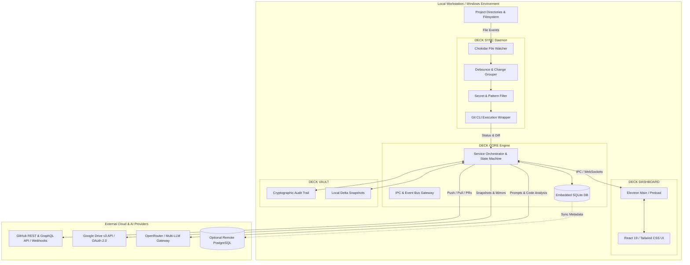

# NIMO-DECK: Personal Development Operating System

[](LICENSE)
[](#monorepo-structure)
[](https://www.typescriptlang.org/)
[](https://react.dev/)
[](https://www.electronjs.org/)

**NIMO-DECK** is an enterprise-grade Personal Development Operating System designed to unify multi-repository software development, local filesystem monitoring, autonomous Git orchestration, Google Drive disaster recovery, and multi-model AI project intelligence into a single developer desktop and web control plane.

---

## 1. Executive Summary & Vision

Software engineers frequently juggle dozens of active repositories, scattered documentation, divergent local branches, unsynced scratch files, and manual backup routines. Traditional tools either focus solely on remote repository management (GitHub/GitLab) or cloud backups (Google Drive/Dropbox), leaving a chaotic gap on the local workstation.

**NIMO-DECK solves this by acting as the unified operating system for your developer environment:**
- **Zero-Friction Git Automation:** Observes file mutations in real time, intelligently groups changes, creates conventional commits with AI-generated or heuristic context, and safely synchronizes with remotes without risking uncommitted work or secret leakage.
- **Two-Tier Disaster Recovery:** Treats GitHub as the canonical source for version-controlled code while maintaining structured, versioned snapshots and documentation mirrors on Google Drive with strict loop prevention.
- **Continuous AI Intelligence:** Passively analyzes repository topologies, commit streams, architectural patterns, technical debt, and missing documentation across all your projects—synthesizing actionable, fact-grounded development roadmaps.
- **Unified Command Center:** Provides an Electron + React 19 desktop cockpit and web dashboard featuring a dark-mode developer-first user experience.

---

## 2. High-Level System Architecture



---

## 3. Core Modules

| Module | Identifier | Primary Responsibilities |
| :--- | :--- | :--- |
| **DECK CORE** | `@nimo-deck/core` | Application lifecycle, configuration management, state machines, event bus, IPC contracts, and plugin/adapter registries. |
| **DECK SYNC** | `@nimo-deck/sync` | High-efficiency Windows file system watcher (Chokidar), change grouping, secret scanning, debounced commits, safe pull/merge rebase logic, and repo health monitoring. |
| **DECK GITHUB** | `@nimo-deck/github` | GitHub REST/GraphQL integration, repository auto-discovery, branch/tag synchronization, issue/PR management, and webhook ingress. |
| **DECK DRIVE** | `@nimo-deck/drive` | Google Drive v3 OAuth 2.0 integration, non-conflicting snapshot generation, SHA-256 fingerprinting, documentation mirroring, and disaster restore engine. |
| **DECK INTELLIGENCE** | `@nimo-deck/intelligence` | Multi-provider AI interface (OpenRouter, Gemini, OpenAI, Claude, Ollama), AST parsing, repository summarization, technical debt audits, and roadmap generators. |
| **DECK VAULT** | `@nimo-deck/vault` | Immutable append-only audit trail, local snapshot storage, changelog extraction, and safe rollback orchestration. |
| **DECK DASHBOARD** | `@nimo-deck/dashboard` | React 19 + Electron cross-platform UI, high-performance virtualized file tree, diff viewer, activity timeline, and system configuration. |
| **DECK SHARED** | `@nimo-deck/shared` | Universal TypeScript schemas (Zod), shared interfaces, cryptographic helpers, and IPC channel constants. |

---

## 4. Key Guarantees & Safety Principles

1. **Non-Destructive Git Workflows:**
   - **Never overwrite uncommitted changes:** Stash or abort on conflict.
   - **Never force-push automatically:** Force-push requires manual override with typed confirmation.
   - **Never commit secrets:** Integrated entropy scanner and regex detector block `.env`, credentials, SSH keys, certificates, and build artifacts before staging.
2. **Deterministic Cloud Separation:**
   - GitHub is the sole source of version-controlled truth.
   - Google Drive is used exclusively for compressed snapshots, release artifacts, and documentation mirrors.
   - Loop-prevention via embedded cryptographic manifest signatures (`deck-sync-manifest.json`).
3. **Fact-Grounded AI Advisory:**
   - AI outputs are clearly demarcated as `VERIFIED_FACT` or `HYPOTHESIS`.
   - The AI engine is read-only and **never silently modifies source code**.
4. **Security by Default:**
   - Credentials stored in Windows Credential Manager / OS Keychain via `keytar`.
   - Zero credential leakage to the frontend renderer.
   - Sandboxed filesystem boundaries preventing path traversal outside declared project roots.

---

## 5. Monorepo Structure

```
NIMO-DECK/
├── .github/                     # GitHub Actions CI/CD workflows
├── apps/
│   ├── desktop/                 # Electron desktop application, secure preload & IPC gateway
│   ├── web/                     # Browser-based command center & API server
│   └── cloud-backend/           # Hosted control plane & multi-device federation server
├── docs/                        # Formal architecture & system specifications
├── packages/
│   ├── core/                    # Core orchestration & lifecycle service
│   ├── sync/                    # File watcher & Git synchronization daemon
│   ├── github/                  # GitHub API adapter & webhook processor
│   ├── drive/                   # Google Drive OAuth & snapshot backup engine
│   ├── intelligence/            # Multi-provider LLM analysis engine
│   ├── vault/                   # History vault, audit logs & recovery manager
│   ├── dashboard/               # Shared React 19 UI, design system & transport contracts
│   └── shared/                  # Common TypeScript types, Zod schemas & utils
├── tests/                       # End-to-end acceptance & security penetration test suites
├── package.json                 # Monorepo root configuration (npm workspaces)
├── tsconfig.base.json           # Base TypeScript configuration
├── .gitignore                   # Enterprise ignore rules
└── README.md                    # Project blueprint and overview
```

---

## 6. Comprehensive Technical Documentation

Explore the detailed architecture specifications in the `docs/` directory:

- 🚀 [**Production & Hardening (docs/PRODUCTION.md)**](docs/PRODUCTION.md): Production lifecycle, Windows packaging, logger, and classification audit.
- 🌐 [**Multi-Device Federation (docs/MULTI-DEVICE.md)**](docs/MULTI-DEVICE.md): Device registration, cryptographic signatures, and network security boundaries.
- 📦 [**Deployment Guide (docs/DEPLOYMENT.md)**](docs/DEPLOYMENT.md): Building Windows installers (.exe), web containerization, and cloud deployment.
- 💻 [**Installation Guide (docs/INSTALLATION.md)**](docs/INSTALLATION.md): Step-by-step setup, directory layout, and upgrade procedures.
- ✅ [**Acceptance & Security Tests (docs/ACCEPTANCE-TESTS.md)**](docs/ACCEPTANCE-TESTS.md): 14-step end-to-end lifecycle verification and security test results.
- 🎛️ [**Dashboard System (docs/DASHBOARD.md)**](docs/DASHBOARD.md): React 19 command center, design system tokens, 11 views, and 9 workspace tabs.
- 🖥️ [**Desktop Architecture (docs/DESKTOP.md)**](docs/DESKTOP.md): Electron main process, context-isolated preload, and IPC gateway.
- 🌐 [**Web Application (docs/WEB-APPLICATION.md)**](docs/WEB-APPLICATION.md): Browser dashboard, authenticated JSON-RPC transport, and standalone mode.
- 🔐 [**Vault & Recovery (docs/VAULT.md)**](docs/VAULT.md): Content-addressed storage (CAS), cryptographic SHA-256 audit chaining, and disaster recovery.
- 📐 [**System Architecture (docs/ARCHITECTURE.md)**](docs/ARCHITECTURE.md): Deep-dive into C4 diagrams, inter-process communication, and modular adapter patterns.
- 🔄 [**Sync Engine Specification (docs/SYNC-ENGINE.md)**](docs/SYNC-ENGINE.md): Chokidar grouping algorithms, commit debouncing, conflict resolution, and health diagnostics.
- 🗄️ [**Database & State Management (docs/DATABASE.md)**](docs/DATABASE.md): SQLite edge database and PostgreSQL hybrid schema definitions with Drizzle ORM.
- 🛡️ [**Security & Threat Model (docs/SECURITY.md)**](docs/SECURITY.md): STRIDE threat analysis, keytar secret isolation, and pre-commit scanning.
- 🧠 [**AI Intelligence Engine (docs/AI-INTELLIGENCE.md)**](docs/AI-INTELLIGENCE.md): Multi-LLM provider integration, AST parsing, confidence scoring, and fact-vs-hypothesis rules.
- 🗺️ [**Engineering Implementation Roadmap (docs/ROADMAP.md)**](docs/ROADMAP.md): Step-by-step phased roadmap from monorepo scaffolding to production release.

---

## 7. Prerequisites & Getting Started

### Prerequisites
- **Node.js**: v20.0.0 or higher (recommended: v22 LTS / v24)
- **npm**: v10.0.0 or higher
- **Git**: v2.40+ installed on system PATH
- **OS**: Windows 10/11 (with cross-platform support planned for macOS/Linux)

### Repository Setup
```bash
# Clone the repository
git clone https://github.com/manav193/NIMO-DECK.git
cd NIMO-DECK

# Install monorepo dependencies
npm install

# Run type check across all workspaces
npm run typecheck

# Run test suites
npm test
```

---

## 8. License

Copyright © 2026 Manav Patel (`manav193`). Distributed under the MIT License.
