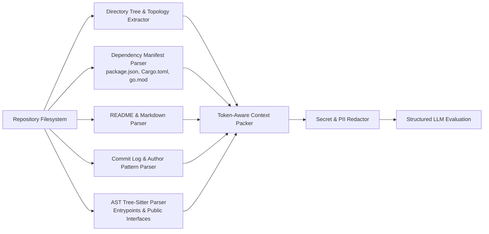

# NIMO-DECK AI Project Intelligence Specification

## 1. Overview & Vision

**DECK INTELLIGENCE (`@nimo-deck/intelligence`)** provides continuous, automated cognitive analysis across all repositories registered in NIMO-DECK. Rather than acting as a simple chat wrapper, it functions as an autonomous technical architect and code auditor that evaluates repository health, architectural integrity, dependency security, and future development opportunities.

---

## 2. Core Architectural Principles

1. **Provider-Agnostic Abstraction:**
   The intelligence engine connects to any LLM provider via a modular adapter interface (`AIProviderAdapter`), preventing vendor lock-in to OpenAI, Anthropic, Google Gemini, or OpenRouter.
2. **Read-Only Non-Destructive Advisory:**
   AI agents **never** autonomously modify source files or make unreviewed commits. Every recommendation is purely advisory and must be accepted or rejected by the developer.
3. **Strict Separation: Facts vs. Hypotheses:**
   Every finding must be explicitly tagged as either a `VERIFIED_FACT` (grounded in parsed AST, lockfiles, or Git history) or an `AI_HYPOTHESIS` (probabilistic inference or subjective recommendation).
4. **Context Window Optimization & Privacy:**
   Code is sanitized, token-optimized, and filtered to exclude sensitive configuration before transmission.

---

## 3. Multi-Provider Adapter Architecture

```mermaid
flowchart TD
    CoreOrchestrator[DECK Core Orchestrator] --> IntelEngine[AI Intelligence Engine]
    
    subgraph AdapterInterface["Unified Provider Adapter Interface"]
        Adapter[AIProviderAdapter]
    end

    IntelEngine --> Adapter
    
    subgraph Providers["Supported Backends"]
        OpenRouter[OpenRouter Gateway\n(Claude 3.5, DeepSeek, Llama 3)]
        Gemini[Google Gemini API\n(Gemini 1.5 Pro / Flash)]
        OpenAI[OpenAI Direct API\n(GPT-4o)]
        Anthropic[Anthropic Direct API]
        Ollama[Local Ollama / vLLM\n(Zero Cloud Egress)]
    end

    Adapter --> OpenRouter
    Adapter --> Gemini
    Adapter --> OpenAI
    Adapter --> Anthropic
    Adapter --> Ollama
```

### TypeScript Adapter Interface
```typescript
export interface CompletionOptions {
  model?: string;
  temperature?: number;
  maxTokens?: number;
  responseFormat?: 'json' | 'text';
}

export interface AIProviderAdapter {
  readonly id: string;
  readonly name: string;
  
  initialize(credentials: Record<string, string>): Promise<void>;
  generateText(prompt: string, options?: CompletionOptions): Promise<string>;
  generateStructured<T>(prompt: string, schema: z.ZodSchema<T>, options?: CompletionOptions): Promise<T>;
  isAvailable(): Promise<boolean>;
}
```

---

## 4. Repository Ingestion & Context Extraction Pipeline

To analyze a repository without exceeding context window limits or burning unnecessary tokens, DECK INTELLIGENCE runs a multi-stage contextual extraction:



### Context Pack Payload Structure
- **Topology:** Complete directory tree excluding build artifacts and dependencies up to 4 levels of depth.
- **Manifests:** Parsed dependencies, development dependencies, scripts, and runtime engines.
- **Documentation:** Full text of `README.md`, `CONTRIBUTING.md`, and API specifications.
- **Commit History:** Summary of the last 50 commits (authors, frequency, file change concentrations).
- **Architecture Signatures:** Top-level exports and route definitions from detected entrypoints (`index.ts`, `main.py`, `src/App.tsx`).

---

## 5. Structured Cognitive Deliverables

### 5.1 Project Summary & Architecture Comprehension
Generates a living technical overview:
- Primary language, framework, and architectural pattern (e.g., Modular Monorepo, Hexagonal, Clean Architecture).
- Key runtime dependencies and external services.
- High-level data flow narrative.

### 5.2 Technical Debt & Anti-Pattern Auditing
Scans for:
- Outdated dependencies with known deprecations.
- Files with high cyclomatic complexity or excessive line count (> 500 lines).
- Orphaned or unused modules and configuration drift.
- Missing automated test suites for critical modules.

### 5.3 Fact vs. Hypothesis Data Model
Every recommendation item is typed with clear epistemic status:

```typescript
export type FactCategory = 'VERIFIED_FACT' | 'AI_HYPOTHESIS';
export type SeverityLevel = 'LOW' | 'MEDIUM' | 'HIGH' | 'CRITICAL';
export type ComplexityScore = 'XS' | 'S' | 'M' | 'L' | 'XL';

export interface AIRecommendation {
  id: string;
  projectId: string;
  title: string;
  category: FactCategory;
  severity: SeverityLevel;
  complexity: ComplexityScore;
  reasoning: string;            // Why this recommendation was made
  expectedBenefits: string;     // Quantifiable or qualitative gains
  dependencies: string[];       // Prerequisite changes or packages
  implementationSteps: string[];// Actionable checklist
  suggestedDiffSnippet?: string;// Optional code diff suggestion
  status: 'PROPOSED' | 'ACCEPTED' | 'REJECTED' | 'RESOLVED';
}
```

#### Example Comparison:
- **`VERIFIED_FACT`:**
  *"Repository defines `react: ^18.2.0` in `package.json` while `@types/react: ^19.0.0` is present, resulting in type definition divergence."*
- **`AI_HYPOTHESIS`:**
  *"Migrating the current custom event bus to RxJS or Node.js EventEmitter3 could reduce memory consumption under high event throughput by an estimated 25%."*

---

## 6. Dynamic Roadmap Generator

DECK INTELLIGENCE organizes recommended improvements into an interactive, multi-phase development roadmap:

```json
{
  "title": "NIMO-DECK Production Hardening Roadmap",
  "generatedAt": "2026-11-09T15:20:00Z",
  "milestones": [
    {
      "phase": 1,
      "name": "Reliability & Safety Hardening",
      "items": [
        {
          "id": "rec_01",
          "title": "Implement stale Git index.lock auto-detection",
          "complexity": "S",
          "category": "VERIFIED_FACT",
          "dependencies": []
        }
      ]
    },
    {
      "phase": 2,
      "name": "Performance Optimization",
      "items": [
        {
          "id": "rec_02",
          "title": "Enable SQLite WAL mode and composite indexing",
          "complexity": "M",
          "category": "AI_HYPOTHESIS",
          "dependencies": ["rec_01"]
        }
      ]
    }
  ]
}
```

---

## 7. Developer Control & Privacy Controls

1. **Zero Egress Mode:** Developers can configure NIMO-DECK to use only local models (via Ollama or local ONNX runtime), ensuring zero source code leaves the workstation.
2. **Per-Project AI Opt-Out:** Sensitive repositories can be marked with `ai_analysis_enabled: false`.
3. **Explicit Data Sanitization:** Inline comments matching `// @nimo-deck-ignore` or file patterns matching `.deckignore` are scrubbed before prompt generation.
