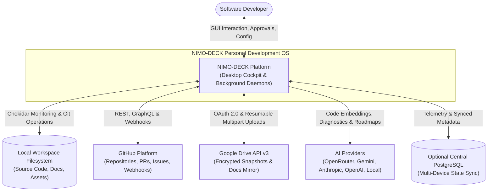
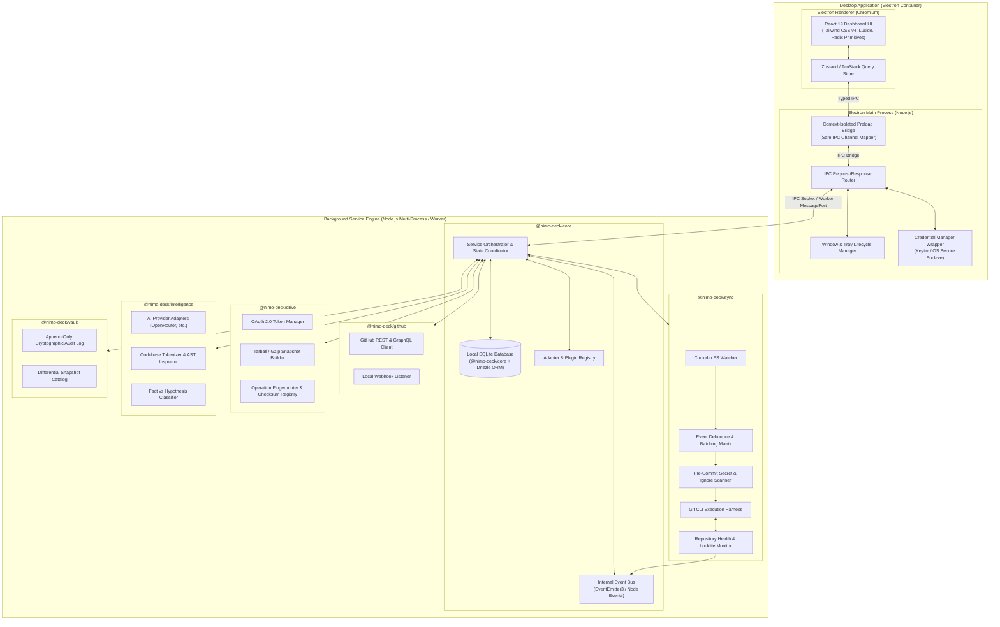
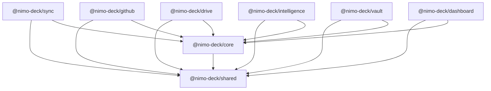

# NIMO-DECK System Architecture Specification

## 1. Architectural Principles & Philosophy

NIMO-DECK is designed as an autonomous, fault-tolerant **Personal Development Operating System**. Unlike conventional Git GUI clients or automated backup utilities, NIMO-DECK operates as a coordinated multi-process desktop platform governed by five core tenets:

1. **Safety First, Automation Second:**
   Automation must never destroy developer data. Every local mutation, pull, rebase, or backup operation is verified against working tree purity, strict exclusion lists, and commit guarantees.
2. **Deterministic Source of Truth:**
   Git and GitHub represent the canonical source for active code. Google Drive serves strictly as an append-only snapshot, documentation mirror, and disaster recovery vault. Cloud synchronization loops are prohibited via cryptographic operation fingerprinting.
3. **Pluggable & Provider-Agnostic Core:**
   External capabilities (AI inference, Cloud storage, Remote Git hosts) are isolated behind strict TypeScript interfaces (`Adapter Pattern`). Replacing an AI provider (e.g., swapping OpenRouter for local Ollama) or storage backend requires zero changes to core orchestration logic.
4. **Local-First, Cloud-Aware:**
   All core functionality—file monitoring, commit construction, local diff analysis, embedded search, and history tracking—functions entirely offline using an embedded SQLite database. Multi-device synchronization synchronizes state through PostgreSQL or encrypted cloud mirrors when available.
5. **Zero Trust Inside the Workspace:**
   Secrets, API keys, credentials, and environmental variables (`.env`, `.pem`, tokens) are intercepted at the boundary before staging or transmission to external services.

---

## 2. C4 Architecture Diagrams

### 2.1 Level 1: System Context Diagram



---

### 2.2 Level 2: Container Diagram



---

## 3. Monorepo Structure & Package Hierarchy

NIMO-DECK is structured as a high-cohesion, low-coupling monorepo using npm workspaces and TypeScript project references.

```
NIMO-DECK/
├── packages/
│   ├── shared/             # Type definitions, Zod schemas, constants, crypto helpers
│   ├── core/               # State machine, local DB, IPC bridge, configuration
│   ├── sync/               # Filesystem watcher, Git CLI automation, safety guards
│   ├── github/             # GitHub API integration, PR/issue tracking, webhooks
│   ├── drive/              # Google Drive OAuth 2.0, snapshots, sync loop defense
│   ├── intelligence/       # Multi-LLM engine, AST parser, roadmap synthesizer
│   ├── vault/              # Cryptographic audit log, backup catalog, rollback engine
│   └── dashboard/          # Electron desktop shell & React 19 web/desktop UI
├── package.json            # Root workspace manifest
├── tsconfig.base.json      # Universal TypeScript compiler options
└── .gitignore              # Enterprise-grade Git exclusions
```

### Dependency Flow Matrix



- **Rule 1:** `@nimo-deck/shared` contains pure logic, Zod validation schemas, interfaces, and utilities. It has no internal package dependencies.
- **Rule 2:** Domain engines (`sync`, `github`, `drive`, `intelligence`, `vault`) register with `@nimo-deck/core` through defined adapter interfaces.
- **Rule 3:** `@nimo-deck/dashboard` consumes services strictly via `@nimo-deck/core` IPC channels or typed API endpoints, preventing direct coupling to OS filesystem watchers or raw sockets.

---

## 4. Subsystem Breakdown & Responsibilities

### 4.1 DECK CORE (`@nimo-deck/core`)
- **Central Coordinator:** Boots background services, orchestrates shutdown procedures, and coordinates multi-step workflows (e.g., sync → commit → push → drive snapshot).
- **Embedded Database Engine:** Manages SQLite database migrations and queries via Drizzle ORM.
- **Configuration Store:** Loads, validates, and serves project configurations, sync intervals, and credentials from encrypted system storage.
- **Event Bus:** Decoupled in-memory publish/subscribe mechanism allowing async notifications (e.g., file changed, commit created, sync error, remote diverged).

### 4.2 DECK SYNC (`@nimo-deck/sync`)
- **Filesystem Observation:** High-performance file tracking via Chokidar.
- **Debounced Change Batching:** Coalesces bursts of file changes (e.g., `npm install`, compile runs, multi-file saves) into distinct atomic changeset batches over a configurable window (default: 5 seconds).
- **Safety Pre-Commit Filter:** Validates modified files against gitignore rules and an immutable security blocklist (`.env*`, private keys, binary dumps).
- **Autonomous Git CLI Harness:** Executes native Git CLI commands through robust child-process wrappers with timeout enforcement, lockfile cleanup, and structured error parsing.
- **Conflict & Divergence Safeguards:** Detects remote branch divergence before pushing; performs only safe fast-forward merges or stashes uncommitted local modifications.

### 4.3 DECK GITHUB (`@nimo-deck/github`)
- **Repository Metadata Sync:** Fetches branch heads, commit histories, tags, pull requests, and issues.
- **Discovery Engine:** Scans authenticated user or organization accounts on GitHub to auto-link local repositories with remote origins.
- **Webhook Bridge:** Exposes a local webhook receiver to capture remote push, PR, and issue events in real time.

### 4.4 DECK DRIVE (`@nimo-deck/drive`)
- **OAuth 2.0 Handshake:** Secure local loopback authentication with refresh token lifecycle.
- **Snapshot Generator:** Compresses sanitized project files (excluding dependencies, build artifacts, and ignored files) into gzip tarballs.
- **Loop Prevention System:** Generates a deterministic SHA-256 manifest of files included in the snapshot. The sync engine ignores changes marked with the NIMO-DECK synchronization token.
- **Disaster Recovery:** Downloads and extracts versioned snapshots to recover repositories or audit historic states.

### 4.5 DECK INTELLIGENCE (`@nimo-deck/intelligence`)
- **Adapter-Based AI Gateway:** Unified client supporting OpenRouter, Google Gemini, Anthropic Claude, OpenAI, and local endpoints (Ollama).
- **Codebase Context Extractor:** Extracts AST summaries, directory trees, `package.json`/`Cargo.toml` dependencies, and commit log patterns.
- **Cognitive Engines:**
  - *Project Summarizer:* Synthesizes high-level architecture narratives.
  - *Tech Debt & Bug Detector:* Spots common anti-patterns, missing tests, and outdated dependencies.
  - *Roadmap Planner:* Generates prioritized feature roadmaps with complexity ratings and dependencies.
- **Strict Fact vs. Hypothesis Separation:** Outputs explicit categorizations (`VERIFIED_FACT` vs `AI_HYPOTHESIS`) to ensure users never confuse deterministic analysis with probabilistic assumptions.

### 4.6 DECK VAULT (`@nimo-deck/vault`)
- **Immutable Audit Trail:** Logs all Git actions, Google Drive uploads, and AI operations into a hash-chained, append-only SQLite log.
- **Differential Snapshots:** Stores lightweight patch sets of local uncommitted workspaces for rollbacks.
- **Changelog Engine:** Auto-compiles markdown release notes from commit histories.

### 4.7 DECK DASHBOARD (`@nimo-deck/dashboard`)
- **Electron Shell:** Controls window states, native system tray, notifications, and secure context-isolated IPC channels.
- **React 19 Presentation Tier:** Responsive UI built with Tailwind CSS, Lucide icons, and Radix primitives.
- **Views:**
  1. *Overview:* Health status across all registered projects.
  2. *Repository Explorer:* Multi-repo tree, uncommitted diffs, branch status.
  3. *Sync Control:* Real-time sync logs, debounce indicators, conflict alerts.
  4. *Google Drive Vault:* Snapshot catalogs, backup schedules, restore points.
  5. *AI Intelligence:* Interactive codebase analysis, debt audits, roadmap visualizer.
  6. *Global Search:* Instant symbol, file, commit, and snapshot indexing.
  7. *Settings & Security:* Secret management, provider API keys, sync rules.

---

## 5. Inter-Process Communication (IPC) Protocol

Communication between the Electron UI, the Node.js Main process, and background workers follows a typed, request-response and push-event RPC architecture:

```
[React 19 UI]
      │
      │ window.deckAPI.invoke('sync:triggerCommit', { projectId: 'p1' })
      ▼
[Preload Script (ContextBridge)]
      │
      │ ipcRenderer.invoke('deck:rpc', channel, payload)
      ▼
[Electron Main Process (IPC Gateway)]
      │
      │ Decodes channel, validates schema with Zod, dispatches to @nimo-deck/core
      ▼
[@nimo-deck/core Orchestrator]
      │
      ├─► Calls @nimo-deck/sync
      ├─► Emits Event on EventBus
      └─► Returns Result
```

### Standardized IPC Message Envelope
```typescript
export interface IPCRequest<T = unknown> {
  id: string;             // UUIDv4 correlation ID
  channel: string;        // e.g. "git:status", "ai:analyze"
  payload: T;             // Validated input payload
  timestamp: number;
}

export interface IPCResponse<T = unknown> {
  id: string;             // Matching correlation ID
  success: boolean;
  data?: T;
  error?: {
    code: string;
    message: string;
    details?: unknown;
  };
  durationMs: number;
}
```

---

## 6. Failure Modes & Resilience Strategies

| Failure Mode | Impact | Mitigation Strategy |
| :--- | :--- | :--- |
| **Git index.lock stuck** | Local Git operations fail | Detect process ownership; if stale for > 60s, inspect PID and safely prune orphan lock. |
| **Remote Git push rejected** | Remote has newer commits | Do NOT force-push. Fetch remote, assess fast-forward compatibility. If non-linear, notify user and pause auto-push. |
| **Network outage during sync** | GitHub or Drive unreachable | Queue operations in local SQLite retry queue with exponential backoff and jitter. |
| **Google Drive token expiry** | Backup uploads fail | Intercept 401 response; trigger silent refresh token exchange; retry request without user interruption. |
| **AI API rate limit / outage** | Intelligence features stall | Fallback to secondary provider or gracefully degrade to local heuristic rule engines. |
| **High disk I/O burst (e.g. node_modules)** | Chokidar event storm | Dynamic debounce cooldown, path exclusion verification before event ingestion. |
