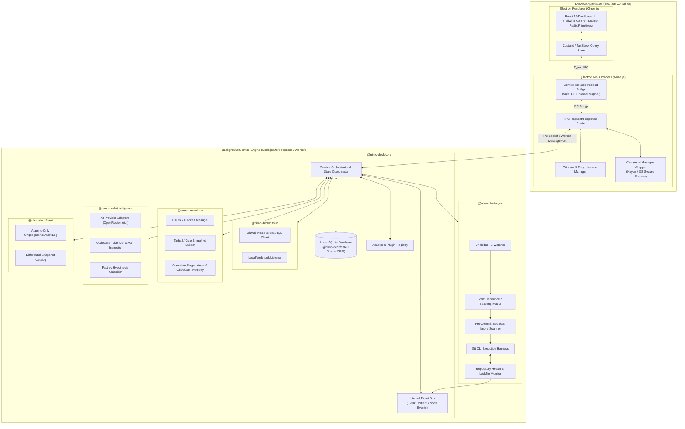
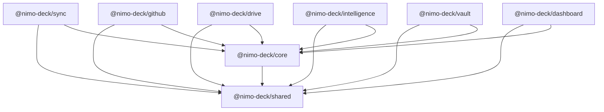

# NIMO-DECK System Architecture Specification

## 1. Architectural Principles & Philosophy

NIMO-DECK is designed as an autonomous, fault-tolerant **Personal Development Operating System**. Unlike conventional Git GUI clients or automated backup utilities, NIMO-DECK operates as a coordinated multi-process desktop platform governed by five core tenets:

1. **Safety First, Automation Second:**
   Automation must never destroy developer data. Every local mutation, pull, rebase, or backup operation is verified against working tree purity, strict exclusion lists, and commit guarantees.
2. **Deterministic Source of Truth:**
   Git and GitHub represent the canonical source for active code. Google Drive serves strictly as an append-only snapshot, documentation mirror, and disaster recovery vault. Cloud synchronization loops are prohibited via cryptographic operation fingerprinting.
3. **Pluggable & Provider-Agnostic Core:**
   External capabilities (AI inference, Cloud storage, Remote Git hosts) are isolated behind strict TypeScript interfaces (`Adapter Pattern`). Replacing an AI provider (e.g., swapping OpenRouter for local Ollama) or storage backend requires zero changes to core orchestration logic.
4. **Local-First, Cloud-Aware:**
   All core functionality—file monitoring, commit construction, local diff analysis, embedded search, and history tracking—functions entirely offline using an embedded SQLite database. Multi-device synchronization synchronizes state through PostgreSQL or encrypted cloud mirrors when available.
5. **Zero Trust Inside the Workspace:**
   Secrets, API keys, credentials, and environmental variables (`.env`, `.pem`, tokens) are intercepted at the boundary before staging or transmission to external services.

---

## 2. C4 Architecture Diagrams

### 2.1 Level 1: System Context Diagram


---

### 2.2 Level 2: Container Diagram



---

## 3. Monorepo Structure & Package Hierarchy

NIMO-DECK is structured as a high-cohesion, low-coupling monorepo using npm workspaces and TypeScript project references.

```
NIMO-DECK/
├── packages/
│   ├── shared/             # Type definitions, Zod schemas, constants, crypto helpers
│   ├── core/               # State machine, local DB, IPC bridge, configuration
│   ├── sync/               # Filesystem watcher, Git CLI automation, safety guards
│   ├── github/             # GitHub API integration, PR/issue tracking, webhooks
│   ├── drive/              # Google Drive OAuth 2.0, snapshots, sync loop defense
│   ├── intelligence/       # Multi-LLM engine, AST parser, roadmap synthesizer
│   ├── vault/              # Cryptographic audit log, backup catalog, rollback engine
│   └── dashboard/          # Electron desktop shell & React 19 web/desktop UI
├── package.json            # Root workspace manifest
├── tsconfig.base.json      # Universal TypeScript compiler options
└── .gitignore              # Enterprise-grade Git exclusions
```

### Dependency Flow Matrix



- **Rule 1:** `@nimo-deck/shared` contains pure logic, Zod validation schemas, interfaces, and utilities. It has no internal package dependencies.
- **Rule 2:** Domain engines (`sync`, `github`, `drive`, `intelligence`, `vault`) register with `@nimo-deck/core` through defined adapter interfaces.
- **Rule 3:** `@nimo-deck/dashboard` consumes services strictly via `@nimo-deck/core` IPC channels or typed API endpoints, preventing direct coupling to OS filesystem watchers or raw sockets.

---

## 4. Subsystem Breakdown & Responsibilities

### 4.1 DECK CORE (`@nimo-deck/core`)
- **Central Coordinator:** Boots background services, orchestrates shutdown procedures, and coordinates multi-step workflows (e.g., sync → commit → push → drive snapshot).
- **Embedded Database Engine:** Manages SQLite database migrations and queries via Drizzle ORM.
- **Configuration Store:** Loads, validates, and serves project configurations, sync intervals, and credentials from encrypted system storage.
- **Event Bus:** Decoupled in-memory publish/subscribe mechanism allowing async notifications (e.g., file changed, commit created, sync error, remote diverged).

### 4.2 DECK SYNC (`@nimo-deck/sync`)
- **Filesystem Observation:** High-performance file tracking via Chokidar.
- **Debounced Change Batching:** Coalesces bursts of file changes (e.g., `npm install`, compile runs, multi-file saves) into distinct atomic changeset batches over a configurable window (default: 5 seconds).
- **Safety Pre-Commit Filter:** Validates modified files against gitignore rules and an immutable security blocklist (`.env*`, private keys, binary dumps).
- **Autonomous Git CLI Harness:** Executes native Git CLI commands through robust child-process wrappers with timeout enforcement, lockfile cleanup, and structured error parsing.
- **Conflict & Divergence Safeguards:** Detects remote branch divergence before pushing; performs only safe fast-forward merges or stashes uncommitted local modifications.

### 4.3 DECK GITHUB (`@nimo-deck/github`)
- **Direct Authenticated Client (`GitHubClient`):** Lightweight, zero-external-dependency REST client injecting credentials strictly from `CredentialStore`. Enforces token redaction in all exceptions, logs, and telemetry.
- **Adaptive Rate Limiting (`GitHubRateLimiter`):** Parses `x-ratelimit-*` headers to track quota consumption and prevent API throttling with automatic reset cooldowns.
- **Protocol-Agnostic URL Parser (`RepoUrlParser`):** Normalizes SSH, HTTPS, and git:// URLs, enabling seamless equality matching regardless of remote protocol configuration.
- **Local-to-Remote Reconciliation (`RepoMapper`):** Correlates local projects against remote GitHub repositories to identify mapped pairs, local-only scratch projects, and remote-only repositories.
- **Secure Webhook Ingress (`GitHubWebhookHandler`):** Validates incoming GitHub webhooks (`push`, `pull_request`, `issues`) using timing-safe HMAC-SHA256 signature verification (`X-Hub-Signature-256`) and delivery ID TTL caching to block replay attacks.
- **Metadata Syncer (`GitHubMetadataSyncer`):** Reconciles remote branch heads, open PRs, and issues directly into the local SQLite database (`remote_sync_states`).
- **Repository Intelligence Inventory (`RepositoryInventoryGenerator`):** Generates centralized inventories detailing inactive repositories (> 60 days), uncommitted local edits, and open issue/PR metrics.

### 4.4 DECK DRIVE (`@nimo-deck/drive`)
- **OAuth 2.0 PKCE Handshake (`OAuthHandler`):** Implements RFC 7636 PKCE OAuth 2.0 flow with local loopback listener (`http://127.0.0.1:4567/oauth/callback`), secure authorization code exchange, and automatic refresh token rotation through `CredentialStore`.
- **Google Drive v3 REST Client (`DriveClient`):** Lightweight client supporting multipart/related uploads with metadata, folder hierarchy creation (`NIMO-DECK / <project-name> / {snapshots, docs, releases}`), recursive folder search, file listing, and binary stream downloads.
- **Snapshot Generator (`SnapshotBuilder`):** Assembles in-memory ZIP archives of project source files, strictly excluding `.git`, `node_modules`, `dist`, `.env`, and files matching `IMMUTABLE_IGNORED_PATTERNS`. Embeds `deck-sync-manifest.json` at archive root.
- **Loop Prevention Engine (`LoopGuard` & `ManifestGenerator`):** Computes deterministic SHA-256 fingerprints across all files. Assigns ephemeral `syncToken` UUIDs with a sliding TTL window (default: 120s) so background watchers discard self-generated filesystem events during backup/restore.
- **Documentation Mirror (`DocsMirror`):** Scans repositories for markdown files (`.md`, `.mdx`), computes content hashes, and synchronizes project documentation to the `docs/` folder in Google Drive.
- **Disaster Restore Engine (`RestoreEngine`):** Downloads and verifies snapshot archives against recorded SHA-256 digests. Mandates explicit user confirmation (`confirmRestore: true`), enforces strict path-traversal safety, and restores verified files to disk without data loss.
- **Backup Service Coordinator (`DriveBackupService`):** High-level orchestrator managing snapshot creation, duplicate upload avoidance via content SHA-256 comparisons, release archives, and persistent audit logging in `drive_backups`.

### 4.5 DECK INTELLIGENCE (`@nimo-deck/intelligence`)
- **Multi-Provider AI Adapters & Registry (`ProviderRegistry`):** Provider-agnostic gateway supporting OpenRouter (`OpenRouterAdapter`), Google Gemini (`GeminiAdapter`), OpenAI (`OpenAIAdapter`), Anthropic Claude (`ClaudeAdapter`), and local Ollama (`OllamaAdapter`). Provides automated retry with exponential backoff, graceful fallback chains, token tracking, and per-model cost estimation (`CostEstimator`).
- **Security & Privacy Defense:**
  - *Secret Redaction (`SecretRedactor`):* Masks API keys, tokens, and high-entropy private keys with `[REDACTED_SECRET]` prior to prompt generation.
  - *Prompt Injection Guard (`PromptInjectionGuard`):* Neutralizes instruction overrides, DAN exploits, and XML delimiter escapes inside untrusted repository files, wrapping context in isolated boundaries.
  - *Privacy Policy (`PrivacyGuard`):* Enforces project-level opt-in / opt-out and local-only offline inference (Ollama-only mode); provides pre-transmission previews.
- **Codebase Ingestion & AST Extraction:**
  - *Repo Scanner (`RepoScanner`):* Recursive discovery strictly excluding `.git`, `node_modules`, `dist`, `.env`, and immutable patterns.
  - *Incremental Indexing (`ContentHashCache`):* SHA-256 fingerprint caching skipping unchanged files between runs.
  - *AST Extraction (`ASTExtractor`):* TypeScript compiler API parsing of classes, functions, interfaces, line ranges, cyclomatic complexity, and export lists.
  - *Manifest & Test Analyzers:* Ingests `package.json` dependencies, devDependencies, and scripts; identifies untested source modules.
  - *Context Packing (`ContextPacker`):* Assembles topology, manifests, docs, AST, and tests into a token-budget-governed prompt payload.
- **Fact vs. Hypothesis Engine (`FactHypothesisEngine`):** Strictly enforces epistemic grounding by verifying that `VERIFIED_FACT` items cite concrete files, symbols, manifests, or commits on disk. Unverifiable claims are demoted to `AI_HYPOTHESIS`.
- **Recommendation Lifecycle & Issue Converter:** Generates structured recommendations and multi-phase roadmaps via Zod schemas (`RecommendationGenerator`). Converts `ACCEPTED` recommendations into GitHub issues (`GitHubIssueConverter`) with explicit user confirmation.
- **Persistent Project Memory (`ProjectMemoryManager`):** Synthesizes and maintains long-term project understanding (purpose, architecture, implemented features, historical decisions, known limitations, current state) in SQLite linked to repository commit SHAs.
- **Cross-Project Intelligence (`CrossProjectAnalyzer`):** Analyzes multi-project relationships, detecting shared dependencies, duplicated symbols for extraction into shared libraries, and licensing compatibility.

### 4.6 DECK VAULT (`@nimo-deck/vault`)
- **Cryptographic Audit Engine:**
  - *Append-Only Audit Recorder (`AuditRecorder`):* Logs operations across Git, Sync, Drive, and Intelligence into the SQLite `audit_logs` table with monotonic sequence numbers, timestamps, and actor attributions (`SYSTEM`, `USER`, `AI_AGENT`).
  - *SHA-256 Hash Chaining (`HashChainManager`):* Chains each audit record to the preceding entry hash (`prevLogHash`), anchored to a well-known `GENESIS_HASH`.
  - *Tamper Detection & Verification (`AuditVerifier` & `AuditQueryService`):* Performs full-chain cryptographic validation from genesis to head, pinpointing exact tampered row IDs, breaks in sequence, or altered payloads. Distinguishes tamper-evident logging from hardware-enforced immutability.
- **Content-Addressed Storage (CAS) & Differential Snapshots:**
  - *CAS Blob Store (`BlobStore`):* Implements zlib-compressed, SHA-256 content-addressed chunk storage with automatic deduplication across files and snapshot generations.
  - *Differential Snapshot Engine (`SnapshotEngine`):* Non-destructively captures full and differential snapshots of Git commit references, staged changes, unstaged changes, and untracked files while strictly excluding ignored dependencies (`node_modules`), `.git`, and secrets (`.env`). Computes root Merkle digests for snapshot manifests.
  - *Snapshot Comparison (`SnapshotComparator`):* Computes file-level diff sets (added, modified, deleted, identical) between arbitrary snapshot manifests.
- **Fail-Safe Disaster Recovery Engine (`SafeRestoreEngine`):**
  - *Restore Preview:* Computes precise file operations (create, overwrite, delete, unchanged) prior to disk mutation.
  - *Pre-Restore Safety Snapshot:* Automatically captures a `SAFETY_PRE_RESTORE` pinned snapshot before any files are modified.
  - *Safety Gates:* Requires explicit user confirmation (`confirmRestore: true`), blocks overwriting uncommitted changes without explicit approval (`allowOverwriteUncommitted: true`), and prevents unintended file deletions without explicit authorization (`allowDeletion: true`).
  - *Integrity Verification & Rollback:* Verifies all CAS blob SHA-256 digests before writing. Automatically rolls back to the pre-restore snapshot if any disk write fails or detects path-traversal attacks.
- **Unified Developer Timeline (`ProjectTimelineService`):**
  - Synthesizes Git commits, sync cycles, Drive backups, AI analyses, snapshots, and audit events into a chronological developer timeline supporting search, event filtering, and date boundaries.
- **Release Changelog Generator (`ChangelogGenerator`):**
  - Categorizes commits into semantic Conventional Commit groups (Breaking Changes, New Features, Bug Fixes, Refactoring).
  - Synthesizes AI release narratives while strictly labeling sections as `[VERIFIED_GIT_HISTORY]` versus `[AI_GENERATED_INTERPRETATION]`.
- **Retention & Disaster Recovery Invariants (`VaultRetentionManager`):**
  - Implements age-based and count-based pruning while enforcing the invariant that the latest recovery point and all pinned snapshots (`isPinned: true`) are never deleted.
- **Drive-Vault Integration (`DriveVaultIntegration`):**
  - Bridges local Vault snapshots with DECK DRIVE cloud backups and provides sync comparison diagnostics.

### 4.7 DECK DASHBOARD (`@nimo-deck/dashboard`, `apps/desktop`, `apps/web`)
- **Shared UI Layer (`packages/dashboard`):** Headless React 19 component library and command center layouts with custom deep navy design tokens (`#0A0F1D`), dark/light theme switcher, collapsible sidebar, command palette (`Ctrl+K`), and notification tray.
- **Electron Desktop Shell (`apps/desktop`):** Secure native desktop app featuring strict context isolation (`contextIsolation: true`, `nodeIntegration: false`), an explicit allowlist in the preload bridge, an external navigation sandbox guard, and an IPC Gateway validating payloads via Zod before invoking the `DesktopRuntime`.
- **Web Command Center (`apps/web`):** Browser-accessible deployment with authenticated JSON-RPC server (`POST /api/deck/rpc`), Bearer token validation (`DECK_AUTH_TOKEN`), and health probes.
- **Transport Abstraction:** `IDashboardTransport` interface with `IpcDashboardTransport`, `HttpDashboardTransport`, and `MockDashboardTransport`.
- **11 System Views:** Overview, Projects, Repository Explorer, Activity Timeline, GitHub Sync, Google Drive, AI Intelligence, Development Roadmaps, Project History, Vault & Recovery, Settings & Security.
- **Project Detail Workspace (9 Tabs):** Dedicated workspace for deep project inspection across Overview, Repository, Activity, Intelligence, Roadmap, Documentation, History, Snapshots, and Settings.
- **Onboarding Wizard:** Interactive 7-step guide for discovery, Git authentication, Drive linking, and AI provider setup.

### 4.8 Cloud Control Plane & Multi-Device Federation (`apps/cloud-backend`)
- **Federated Architecture:** Hub-and-spoke multi-device control plane enabling cross-workstation metadata federation without exposing local filesystems or private ports to the public internet.
- **Session Manager:** Issues short-lived JWT access tokens and rotating refresh tokens with clock-skew tolerance and instant session revocation.
- **Rate Limiting:** Sliding-window rate limiter preventing API abuse and brute-force pairing attempts.
- **Cryptographic Payloads:** Ingests and broadcasts signed `CrossDeviceSyncPayload` envelopes using device Ed25519 or HMAC keys to verify origin and detect branch/audit divergence.
- **Local Isolation Invariant:** Local filesystem absolute paths remain strictly local to each device and are never broadcast across the federation boundary.

---

## 5. Inter-Process Communication (IPC) Protocol

Communication between the Electron UI, the Node.js Main process, and background workers follows a typed, request-response and push-event RPC architecture:

```
[React 19 UI]
      │
      │ window.deckAPI.invoke('sync:triggerCommit', { projectId: 'p1' })
      ▼
[Preload Script (ContextBridge)]
      │
      │ ipcRenderer.invoke('deck:rpc', channel, payload)
      ▼
[Electron Main Process (IPC Gateway)]
      │
      │ Decodes channel, validates schema with Zod, dispatches to @nimo-deck/core
      ▼
[@nimo-deck/core Orchestrator]
      │
      ├─► Calls @nimo-deck/sync
      ├─► Emits Event on EventBus
      └─► Returns Result
```

### Standardized IPC Message Envelope
```typescript
export interface IPCRequest<T = unknown> {
  id: string;             // UUIDv4 correlation ID
  channel: string;        // e.g. "git:status", "ai:analyze"
  payload: T;             // Validated input payload
  timestamp: number;
}

export interface IPCResponse<T = unknown> {
  id: string;             // Matching correlation ID
  success: boolean;
  data?: T;
  error?: {
    code: string;
    message: string;
    details?: unknown;
  };
  durationMs: number;
}
```

---

## 6. Failure Modes & Resilience Strategies

| Failure Mode | Impact | Mitigation Strategy |
| :--- | :--- | :--- |
| **Git index.lock stuck** | Local Git operations fail | Detect process ownership; if stale for > 60s, inspect PID and safely prune orphan lock. |
| **Remote Git push rejected** | Remote has newer commits | Do NOT force-push. Fetch remote, assess fast-forward compatibility. If non-linear, notify user and pause auto-push. |
| **Network outage during sync** | GitHub or Drive unreachable | Queue operations in local SQLite retry queue with exponential backoff and jitter. |
| **Google Drive token expiry** | Backup uploads fail | Intercept 401 response; trigger silent refresh token exchange; retry request without user interruption. |
| **AI API rate limit / outage** | Intelligence features stall | Fallback to secondary provider or gracefully degrade to local heuristic rule engines. |
| **High disk I/O burst (e.g. node_modules)** | Chokidar event storm | Dynamic debounce cooldown, path exclusion verification before event ingestion. |
