# NIMO-DECK Database & State Architecture

## 1. Dual-Database Architectural Strategy

NIMO-DECK incorporates a hybrid, local-first data architecture:

```
┌────────────────────────────────────────────────────────┐
│               Workstation A (Windows/Linux)            │
│  ┌───────────────────────┐   ┌──────────────────────┐  │
│  │   DECK Application    │<──┤  Embedded SQLite DB  │  │
│  │  (Zero-Latency Edge)  │   │  (~/.nimo-deck/db)   │  │
│  └───────────┬───────────┘   └──────────────────────┘  │
└──────────────┼─────────────────────────────────────────┘
               │ (Optional Secure Sync Protocol)
               ▼
┌────────────────────────────────────────────────────────┐
│            Central Cloud / Multi-Device Hub            │
│  ┌──────────────────────────────────────────────────┐  │
│  │           PostgreSQL Database Cluster            │  │
│  │      (Cross-Device State, Audits, Analytics)     │  │
│  └──────────────────────────────────────────────────┘  │
└────────────────────────────────────────────────────────┘
```

1. **Embedded SQLite (Edge State Engine):**
   - The primary data store on every developer machine.
   - Zero-latency query response (< 2ms) using WAL (Write-Ahead Logging) mode.
   - Fully operational without network connectivity.
   - Located by default at `%USERPROFILE%/.nimo-deck/nimo-deck.sqlite` on Windows.
2. **PostgreSQL (Optional Federated Cloud Hub):**
   - Enables developers with multiple devices (workstation, laptop, cloud VM) to view unified project statuses, sync states, and AI roadmaps.
   - Both engines share isomorphic Drizzle ORM schemas.

---

## 2. Entity-Relationship Diagram (ERD)

```mermaid
erDiagram
    PROJECTS ||--|| SYNC_CONFIGS : has
    PROJECTS ||--o{ SYNC_EVENTS : logs
    PROJECTS ||--o{ COMMIT_HISTORY : tracks
    PROJECTS ||--o{ REMOTE_SYNC_STATES : monitors
    PROJECTS ||--o{ DRIVE_BACKUPS : archives
    PROJECTS ||--o{ AI_ANALYSES : analyzes
    PROJECTS ||--o{ AUDIT_LOGS : audits

    AI_ANALYSES ||--o{ AI_RECOMMENDATIONS : generates
    PROJECTS ||--o{ AI_ROADMAPS : plans

    PROJECTS {
        string id PK "UUIDv4"
        string name "Project display name"
        string local_path "Absolute directory path"
        string git_remote_url "Origin remote URL"
        string status "ACTIVE | PAUSED | ERROR"
        datetime created_at
        datetime updated_at
    }

    SYNC_CONFIGS {
        string project_id PK, FK
        boolean auto_commit_enabled
        integer debounce_window_ms
        integer max_wait_ms
        string auto_push_mode "OFF | ON_COMMIT | SCHEDULED"
        integer push_interval_sec
        boolean ai_commit_messages
        boolean dry_run_mode
        datetime updated_at
    }

    SYNC_EVENTS {
        string id PK "UUIDv4"
        string project_id FK
        string event_type "FILE_CHANGE | COMMIT | PULL | PUSH | CONFLICT"
        string status "SUCCESS | PENDING | FAILED"
        string details_json "Structured metadata"
        datetime created_at
    }

    COMMIT_HISTORY {
        string id PK "UUIDv4"
        string project_id FK
        string commit_sha "Git commit hash (40 chars)"
        string branch "Branch name"
        string author_name
        string author_email
        string message "Commit subject and body"
        integer files_changed_count
        boolean is_auto_generated
        datetime committed_at
    }

    REMOTE_SYNC_STATES {
        string id PK "UUIDv4"
        string project_id FK
        string branch_name
        string local_head_sha
        string remote_head_sha
        string sync_status "IN_SYNC | AHEAD | BEHIND | DIVERGED"
        datetime last_synced_at
    }

    DRIVE_BACKUPS {
        string id PK "UUIDv4"
        string project_id FK
        string drive_file_id "Google Drive API file ID"
        string drive_folder_id
        string snapshot_sha256 "Payload cryptographic checksum"
        integer size_bytes
        string backup_type "SNAPSHOT | DOCS_MIRROR"
        string status "PENDING | COMPLETED | FAILED"
        datetime created_at
    }

    AI_ANALYSES {
        string id PK "UUIDv4"
        string project_id FK
        string model_used "e.g. anthropic/claude-3.5-sonnet"
        string summary_markdown
        string tech_debt_report
        string security_report
        datetime created_at
    }

    AI_RECOMMENDATIONS {
        string id PK "UUIDv4"
        string analysis_id FK
        string project_id FK
        string title
        string category "VERIFIED_FACT | AI_HYPOTHESIS"
        string severity "LOW | MEDIUM | HIGH | CRITICAL"
        string complexity "XS | S | M | L | XL"
        string reasoning
        string expected_benefits
        string dependencies_json
        string status "PROPOSED | ACCEPTED | REJECTED | RESOLVED"
        datetime created_at
    }

    AI_ROADMAPS {
        string id PK "UUIDv4"
        string project_id FK
        string title
        string roadmap_json "Structured milestones & items"
        datetime generated_at
    }

    AUDIT_LOGS {
        string id PK "UUIDv4"
        string project_id FK
        string actor "SYSTEM | USER | AI_AGENT"
        string action "e.g. GIT_COMMIT, DRIVE_RESTORE"
        string payload_hash "SHA-256 of execution data"
        string prev_log_hash "Cryptographic chain link"
        datetime created_at
    }
```



---

## 3. Schema Definitions in Drizzle ORM (TypeScript)

```typescript
import { sqliteTable, text, integer } from 'drizzle-orm/sqlite-core';

export const projects = sqliteTable('projects', {
  id: text('id').primaryKey(),
  name: text('name').notNull(),
  localPath: text('local_path').notNull().unique(),
  gitRemoteUrl: text('git_remote_url'),
  status: text('status', { enum: ['ACTIVE', 'PAUSED', 'ERROR'] }).default('ACTIVE').notNull(),
  createdAt: integer('created_at', { mode: 'timestamp' }).notNull(),
  updatedAt: integer('updated_at', { mode: 'timestamp' }).notNull(),
});

export const syncConfigs = sqliteTable('sync_configs', {
  projectId: text('project_id').primaryKey().references(() => projects.id, { onDelete: 'cascade' }),
  autoCommitEnabled: integer('auto_commit_enabled', { mode: 'boolean' }).default(true).notNull(),
  debounceWindowMs: integer('debounce_window_ms').default(5000).notNull(),
  maxWaitMs: integer('max_wait_ms').default(30000).notNull(),
  autoPushMode: text('auto_push_mode', { enum: ['OFF', 'ON_COMMIT', 'SCHEDULED'] }).default('ON_COMMIT').notNull(),
  pushIntervalSec: integer('push_interval_sec').default(300).notNull(),
  aiCommitMessages: integer('ai_commit_messages', { mode: 'boolean' }).default(false).notNull(),
  dryRunMode: integer('dry_run_mode', { mode: 'boolean' }).default(false).notNull(),
  updatedAt: integer('updated_at', { mode: 'timestamp' }).notNull(),
});

export const syncEvents = sqliteTable('sync_events', {
  id: text('id').primaryKey(),
  projectId: text('project_id').references(() => projects.id, { onDelete: 'cascade' }).notNull(),
  eventType: text('event_type').notNull(),
  status: text('status', { enum: ['SUCCESS', 'PENDING', 'FAILED'] }).notNull(),
  detailsJson: text('details_json').notNull(),
  createdAt: integer('created_at', { mode: 'timestamp' }).notNull(),
});

export const commitHistory = sqliteTable('commit_history', {
  id: text('id').primaryKey(),
  projectId: text('project_id').references(() => projects.id, { onDelete: 'cascade' }).notNull(),
  commitSha: text('commit_sha', { length: 40 }).notNull(),
  branch: text('branch').notNull(),
  authorName: text('author_name').notNull(),
  authorEmail: text('author_email').notNull(),
  message: text('message').notNull(),
  filesChangedCount: integer('files_changed_count').notNull(),
  isAutoGenerated: integer('is_auto_generated', { mode: 'boolean' }).notNull(),
  committedAt: integer('committed_at', { mode: 'timestamp' }).notNull(),
});

export const remoteSyncStates = sqliteTable('remote_sync_states', {
  id: text('id').primaryKey(),
  projectId: text('project_id').references(() => projects.id, { onDelete: 'cascade' }).notNull(),
  branchName: text('branch_name').notNull(),
  localHeadSha: text('local_head_sha', { length: 40 }).notNull(),
  remoteHeadSha: text('remote_head_sha', { length: 40 }).notNull(),
  syncStatus: text('sync_status', { enum: ['IN_SYNC', 'AHEAD', 'BEHIND', 'DIVERGED'] }).notNull(),
  lastSyncedAt: integer('last_synced_at', { mode: 'timestamp' }).notNull(),
});

export const driveBackups = sqliteTable('drive_backups', {
  id: text('id').primaryKey(),
  projectId: text('project_id').references(() => projects.id, { onDelete: 'cascade' }).notNull(),
  driveFileId: text('drive_file_id').notNull(),
  driveFolderId: text('drive_folder_id').notNull(),
  snapshotSha256: text('snapshot_sha256').notNull(),
  sizeBytes: integer('size_bytes').notNull(),
  backupType: text('backup_type', { enum: ['SNAPSHOT', 'DOCS_MIRROR'] }).notNull(),
  status: text('status', { enum: ['PENDING', 'COMPLETED', 'FAILED'] }).notNull(),
  createdAt: integer('created_at', { mode: 'timestamp' }).notNull(),
});

export const aiAnalyses = sqliteTable('ai_analyses', {
  id: text('id').primaryKey(),
  projectId: text('project_id').references(() => projects.id, { onDelete: 'cascade' }).notNull(),
  modelUsed: text('model_used').notNull(),
  summaryMarkdown: text('summary_markdown').notNull(),
  techDebtReport: text('tech_debt_report').notNull(),
  securityReport: text('security_report').notNull(),
  createdAt: integer('created_at', { mode: 'timestamp' }).notNull(),
});

export const aiRecommendations = sqliteTable('ai_recommendations', {
  id: text('id').primaryKey(),
  analysisId: text('analysis_id').references(() => aiAnalyses.id, { onDelete: 'cascade' }).notNull(),
  projectId: text('project_id').references(() => projects.id, { onDelete: 'cascade' }).notNull(),
  title: text('title').notNull(),
  category: text('category', { enum: ['VERIFIED_FACT', 'AI_HYPOTHESIS'] }).notNull(),
  severity: text('severity', { enum: ['LOW', 'MEDIUM', 'HIGH', 'CRITICAL'] }).notNull(),
  complexity: text('complexity', { enum: ['XS', 'S', 'M', 'L', 'XL'] }).notNull(),
  reasoning: text('reasoning').notNull(),
  expectedBenefits: text('expected_benefits').notNull(),
  dependenciesJson: text('dependencies_json').notNull(),
  status: text('status', { enum: ['PROPOSED', 'ACCEPTED', 'REJECTED', 'RESOLVED'] }).default('PROPOSED').notNull(),
  createdAt: integer('created_at', { mode: 'timestamp' }).notNull(),
});

export const auditLogs = sqliteTable('audit_logs', {
  id: text('id').primaryKey(),
  projectId: text('project_id').references(() => projects.id, { onDelete: 'set null' }),
  actor: text('actor', { enum: ['SYSTEM', 'USER', 'AI_AGENT'] }).notNull(),
  action: text('action').notNull(),
  payloadHash: text('payload_hash').notNull(),
  prevLogHash: text('prev_log_hash').notNull(),
  createdAt: integer('created_at', { mode: 'timestamp' }).notNull(),
});
```

---

## 4. Performance, Indexing & Data Retention

### 4.1 Indexing Strategy
To guarantee millisecond query performance on the developer desktop:
- `idx_projects_local_path`: Unique index on `projects.local_path`.
- `idx_sync_events_project_created`: Composite index on `(project_id, created_at DESC)`.
- `idx_commits_sha`: Index on `commit_history.commit_sha`.
- `idx_recommendations_status`: Index on `ai_recommendations.status`.

### 4.2 Audit Log Hash-Chaining
Every record in `audit_logs` includes `prevLogHash` computed as:
$$\text{LogHash}_n = \text{SHA256}(\text{LogHash}_{n-1} + \text{id} + \text{actor} + \text{action} + \text{payloadHash} + \text{createdAt})$$
This guarantees tamper-evident validation across local Git and Google Drive synchronization history.
