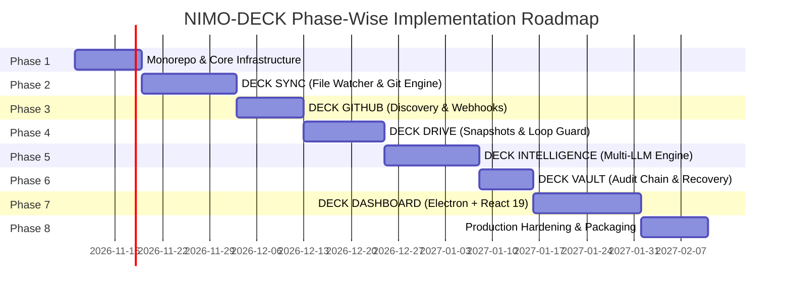

# NIMO-DECK Engineering Implementation Roadmap

## 1. Roadmap Architecture & Phasing Strategy

NIMO-DECK is built in an incremental, test-driven manner across eight distinct engineering phases. Each phase establishes a verified, production-grade module with unit and integration tests before subsequent layers are integrated.

---

## 2. Detailed Phase Breakdown

### Phase 1: Monorepo Foundation & Core Infrastructure
**Status:** `[COMPLETED]` (Verified: 2026-11-09)

**Primary Objectives:**
Establish the monorepo structure, TypeScript configuration, package boundary definitions, shared schemas, cryptographic utilities, and embedded SQLite database engine.

- **Tasks Completed:**
  - [x] Configure root `package.json` with npm workspaces (`packages/*`), TypeScript 5.7, ESLint 9, and Vitest.
  - [x] Implement `@nimo-deck/shared`:
    - [x] Common Zod schemas (`Project`, `SyncConfig`, `CommitRecord`, `RemoteSyncState`, `DriveBackup`, `AIRecommendation`, `AIAnalysis`, `AIRoadmap`, `AuditLogEntry`).
    - [x] Cryptographic utilities: Shannon entropy calculation, high-confidence secret detection regexes, SHA-256 payload hashing, tamper-evident audit hash-chain calculator.
    - [x] Immutable ignore patterns (`IMMUTABLE_IGNORED_PATTERNS`, `isImmutableIgnored`).
    - [x] Typed IPC request, response, error envelopes and standard channel constants.
  - [x] Implement `@nimo-deck/core`:
    - [x] Embedded SQLite connection with Drizzle ORM, WAL journal mode, and foreign key enforcement.
    - [x] Idempotent migration runner (`runMigrations`) creating 11 core tables and composite indexes.
    - [x] Clean architecture repositories: `ProjectRepository`, `SyncConfigRepository`, `SyncEventRepository`, `CommitHistoryRepository`, `RemoteSyncStateRepository`, `AIAnalysisRepository`.
    - [x] Cryptographic `AuditLogRepository` with SHA-256 hash chaining and automated tamper-detection validator (`verifyChainIntegrity`).
    - [x] Typed event bus (`DeckEventBus` using `EventEmitter3`).
    - [x] Credential store abstraction (`CredentialStore`, `InMemoryCredentialStore`).
- **Verification Gate:**
  - [x] 100% test pass rate: 7 test suites, 29 unit and integration tests passing (`npm test`).
  - [x] Zero TypeScript errors: `npm run typecheck` across all project references.
  - [x] Clean linting: `npm run lint` with 0 errors and 0 warnings.
  - [x] Package builds: `npm run build` compiles clean `.d.ts` declaration maps and `.js` bundles.

---

### Phase 2: Local Git Engine & Background Sync Daemon (`@nimo-deck/sync`)
**Status:** `[PENDING - NEXT]`
**Primary Objectives:**
Implement filesystem observation, event debouncing, pre-commit secret scanning, Git CLI automation, conventional commit generation, and safe push/pull logic.

- **Tasks:**
  1. Build `ChokidarWatcher` with Windows NTFS debounce stabilization.
  2. Implement `DebounceBatcher` with sliding quiet window (5s) and max timeout (30s).
  3. Implement `SafetyFilter`:
     - Immutable ignore rules enforcement.
     - Regex secret signature matching.
     - Shannon entropy threshold checker.
  4. Build `GitCLI` wrapper:
     - Argument sanitization array execution (preventing shell injection).
     - Timeout handling, lockfile (`.git/index.lock`) detection, and clean recovery.
     - Porcellain status, diff calculation, commit, safe pull (`--ff-only`), and push.
  5. Build `ConventionalCommitGenerator` heuristic analyzer.
  6. Implement repository health monitor (detached HEAD, dirty tree, loose objects).
- **Verification Gate:**
  - Mock filesystem integration test simulating bursts of 1,000 file writes coalesced into a single atomic commit.
  - Test verifying `.env` and high-entropy private keys are blocked from staging.
  - Test verifying non-linear history divergence pauses auto-push and alerts user.

---

### Phase 3: GitHub Integration & Remote Orchestration (`@nimo-deck/github`)
**Primary Objectives:**
Seamlessly integrate GitHub REST and GraphQL APIs for repository discovery, branch tracking, pull requests, issues, and real-time webhook ingestion.

- **Tasks:**
  1. Implement `GitHubAdapter` using Octokit.
  2. Build repository discovery to match local directory paths with remote GitHub repositories.
  3. Fetch pull requests, active branches, open issues, and remote commit heads.
  4. Create local webhook receiver server to capture remote push and PR events.
  5. Sync remote head SHAs into `remote_sync_states` table.
- **Verification Gate:**
  - Unit tests with mocked GitHub REST/GraphQL responses verifying repository discovery and status reconciliation.

---

### Phase 4: Google Drive Backup & Snapshot System (`@nimo-deck/drive`)
**Primary Objectives:**
Implement Google Drive v3 OAuth 2.0 integration, non-conflicting snapshot generation, SHA-256 fingerprinting, documentation mirroring, and disaster restore engine.

- **Tasks:**
  1. Implement OAuth 2.0 PKCE flow with local loopback listener.
  2. Build `SnapshotBuilder`:
     - Creates compressed `.tar.gz` snapshots of sanitized repositories.
     - Automatically excludes ignored dependencies (`node_modules`, `dist`, `.git`).
  3. Implement `LoopGuard`:
     - Embeds `deck-sync-manifest.json` containing cryptographic fingerprints.
     - Ensures Google Drive uploads never trigger redundant local Git syncs.
  4. Implement `DriveClient`:
     - Resumable multipart upload for large snapshots.
     - Automatic folder creation (`NIMO-DECK / <project-name> / snapshots`).
  5. Implement `RestoreEngine`:
     - Validates snapshot integrity against recorded SHA-256 before extraction.
- **Verification Gate:**
  - End-to-end backup and restore test verifying exact byte parity of recovered source files.

---

### Phase 5: AI Project Intelligence Engine (`@nimo-deck/intelligence`)
**Primary Objectives:**
Build a multi-provider LLM gateway, AST and project context extraction pipeline, structured cognitive outputs, and the Fact vs. Hypothesis engine.

- **Tasks:**
  1. Build `AIProviderAdapter` interface with implementations:
     - OpenRouter (Default gateway).
     - Google Gemini (Direct API).
     - OpenAI & Anthropic (Direct APIs).
     - Ollama (Local offline model).
  2. Implement `ContextExtractor`:
     - Directory tree serializer.
     - Dependency manifest parser (`package.json`, `Cargo.toml`, etc.).
     - README and markdown extractor.
     - Git commit history analyzer.
  3. Implement cognitive analysis pipelines:
     - Project summary & architectural pattern recognition.
     - Technical debt & security vulnerability audit.
     - Dynamic roadmap synthesizer with complexity & dependencies.
  4. Implement `FactHypothesisClassifier`:
     - Enforces deterministic tagging (`VERIFIED_FACT` vs `AI_HYPOTHESIS`).
- **Verification Gate:**
  - Mocked LLM responses validated against Zod schemas ensuring no hallucinated or unformatted fields.

---

### Phase 6: Vault, Audit Logs & Disaster Recovery (`@nimo-deck/vault`)
**Primary Objectives:**
Provide an immutable, tamper-evident audit log and lightweight local diff snapshot recovery.

- **Tasks:**
  1. Implement `AuditLogger` with cryptographic SHA-256 hash chaining.
  2. Implement local delta snapshot manager (temporary git stash patches).
  3. Build changelog generator from Git commit streams.
  4. Implement safe rollback coordinator.
- **Verification Gate:**
  - Test verifying that any manual tampering with an audit log row invalidates the chain validation check.

---

### Phase 7: Modern Desktop & Web Dashboard (`@nimo-deck/dashboard`)
**Primary Objectives:**
Create a modern, responsive, developer-oriented Electron desktop application and web interface using React 19 and Tailwind CSS.

- **Tasks:**
  1. Configure Electron main process with context-isolated preload scripts and safe IPC channels.
  2. Scaffolding React 19 app with Tailwind CSS, Lucide icons, and Radix primitives.
  3. Implement 11 core dashboard views:
     - **Overview:** System health, active sync daemons, quick stats.
     - **Projects:** Card and table views of managed repositories.
     - **Repository Explorer:** Virtualized file tree, diff inspector, branch switcher.
     - **Activity Timeline:** Real-time stream of Git actions and Drive backups.
     - **GitHub Synchronization:** Remote branches, PRs, issues, divergence alerts.
     - **Google Drive:** Snapshot catalog, manual snapshot trigger, restore point manager.
     - **AI Intelligence:** Project summaries, architecture insights, debt audits.
     - **Development Roadmaps:** Interactive milestone view with status toggles.
     - **Project History:** Commit logs, author analytics, changelogs.
     - **Backups & Recovery:** Local stashes, Drive archives, integrity verification.
     - **Settings & Security:** Provider API keys, debounce sliders, ignore rule editor.
  4. Real-time push updates from DECK Core via IPC events.
- **Verification Gate:**
  - Component tests, rendering benchmarks (< 16ms frame budget), and IPC channel security audits.

---

### Phase 8: Multi-Device Sync, Production Hardening & Packaging
**Primary Objectives:**
Package NIMO-DECK for Windows distribution, harden performance, conduct security penetration tests, and verify multi-device metadata synchronization.

- **Tasks:**
  1. Build Windows installer (.exe / .msi) using Electron Forge or Electron Builder.
  2. Implement optional central PostgreSQL sync adapter for multi-workstation setups.
  3. System resource profiling: idle RAM < 120MB, CPU < 1% when monitoring 20+ repos.
  4. Comprehensive documentation and release tagging on GitHub (`v1.0.0`).
- **Verification Gate:**
  - End-to-end installation test on clean Windows environment.
  - Stress test monitoring 25 active repositories simultaneously.
