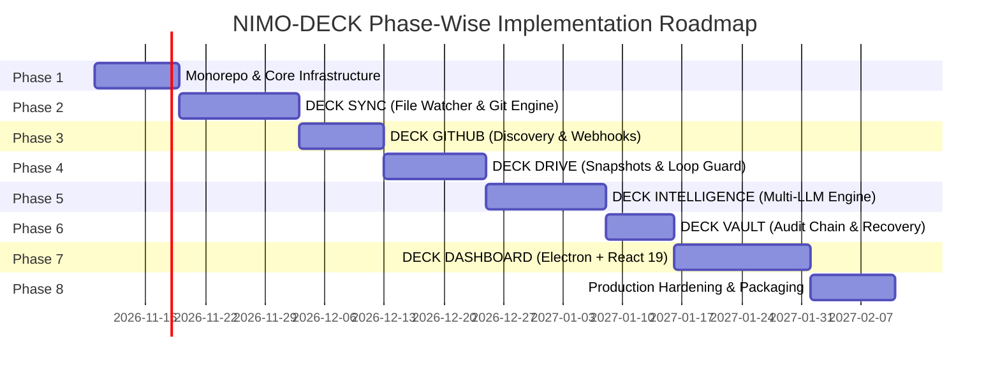

# NIMO-DECK Engineering Implementation Roadmap

## 1. Roadmap Architecture & Phasing Strategy

NIMO-DECK is built in an incremental, test-driven manner across eight distinct engineering phases. Each phase establishes a verified, production-grade module with unit and integration tests before subsequent layers are integrated.

---

## 2. Detailed Phase Breakdown

### Phase 1: Monorepo Foundation & Core Infrastructure
**Status:** `[COMPLETED]` (Verified: 2026-11-09)

**Primary Objectives:**
Establish the monorepo structure, TypeScript configuration, package boundary definitions, shared schemas, cryptographic utilities, and embedded SQLite database engine.

- **Tasks Completed:**
  - [x] Configure root `package.json` with npm workspaces (`packages/*`), TypeScript 5.7, ESLint 9, and Vitest.
  - [x] Implement `@nimo-deck/shared`:
    - [x] Common Zod schemas (`Project`, `SyncConfig`, `CommitRecord`, `RemoteSyncState`, `DriveBackup`, `AIRecommendation`, `AIAnalysis`, `AIRoadmap`, `AuditLogEntry`).
    - [x] Cryptographic utilities: Shannon entropy calculation, high-confidence secret detection regexes, SHA-256 payload hashing, tamper-evident audit hash-chain calculator.
    - [x] Immutable ignore patterns (`IMMUTABLE_IGNORED_PATTERNS`, `isImmutableIgnored`).
    - [x] Typed IPC request, response, error envelopes and standard channel constants.
  - [x] Implement `@nimo-deck/core`:
    - [x] Embedded SQLite connection with Drizzle ORM, WAL journal mode, and foreign key enforcement.
    - [x] Idempotent migration runner (`runMigrations`) creating 11 core tables and composite indexes.
    - [x] Clean architecture repositories: `ProjectRepository`, `SyncConfigRepository`, `SyncEventRepository`, `CommitHistoryRepository`, `RemoteSyncStateRepository`, `AIAnalysisRepository`.
    - [x] Cryptographic `AuditLogRepository` with SHA-256 hash chaining and automated tamper-detection validator (`verifyChainIntegrity`).
    - [x] Typed event bus (`DeckEventBus` using `EventEmitter3`).
    - [x] Credential store abstraction (`CredentialStore`, `InMemoryCredentialStore`).
- **Verification Gate:**
  - [x] 100% test pass rate: 7 test suites, 29 unit and integration tests passing (`npm test`).
  - [x] Zero TypeScript errors: `npm run typecheck` across all project references.
  - [x] Clean linting: `npm run lint` with 0 errors and 0 warnings.
  - [x] Package builds: `npm run build` compiles clean `.d.ts` declaration maps and `.js` bundles.

---

### Phase 2: Local Git Engine & Background Sync Daemon (`@nimo-deck/sync`)
**Status:** `[COMPLETED]` (Verified: 2026-11-09)

**Primary Objectives:**
Implement filesystem observation, event debouncing, pre-commit secret scanning, Git CLI automation, conventional commit generation, safe push/pull logic, and multi-repository background daemon foundation.

- **Tasks Completed:**
  - [x] Implemented `GitCLI` with safe child process execution (`execFile`), argument array parameterization (zero shell injection), timeout handling, and destructive command interception (`--force`, `-f`, `clean -fd`, `--hard` prohibited).
  - [x] Implemented `GitStatusInspector` parsing machine-readable `git status --porcelain=v2 --branch` for accurate dirty-tree, branch, untracked, ahead/behind, and conflict tracking.
  - [x] Implemented `GitDiffInspector` for stat, numstat, and truncated diff summaries for AI prompt window safety.
  - [x] Implemented `GitLockMonitor` detecting stale `.git/index.lock` files (> 60s mtime) with automated orphan cleanup.
  - [x] Implemented `DebounceBatcher` with sliding quiet inactivity window (default 5s) and maximum burst ceiling timeout (`maxWaitMs`, default 30s).
  - [x] Implemented `RepoFileWatcher` wrapping `chokidar.watch` with unconditional immutable ignore rule filtering and pause/resume lifecycle.
  - [x] Implemented `PreCommitScanner` evaluating candidate files for immutable ignore patterns, 50MB file size limits, credential signatures, and Shannon entropy. Blocks and quarantines secrets before `git add`.
  - [x] Implemented `CommitMessageService` and `ConventionalCommitBuilder` inferring semantic Conventional Commit messages with monorepo package scope detection, plus an injectable `AICommitMessageGenerator` interface with graceful heuristic fallback.
  - [x] Implemented `RepoMutex` for in-memory exclusive synchronization locking per repository to prevent race conditions.
  - [x] Implemented `RetryQueue` providing exponential backoff with randomized jitter for network failures.
  - [x] Implemented `SyncCoordinator` linking mutex locks, stale lock pruning, safety scanning, staging, committing, database recording, safe pull (`--ff-only`), conflict alerting, and event emission.
  - [x] Implemented `SyncDaemonManager` orchestrating multi-repository background surveillance with start/stop/pause/resume and manual sync triggers.
- **Verification Gate:**
  - [x] 100% test pass rate: 14 test suites, 52 unit and integration tests passing (`npm test`).
  - [x] Pre-commit security verification: `.env` and high-entropy private keys quarantined and blocked from staging.
  - [x] Non-linear history divergence alert: automatic push halted on divergence without silent rebase.
  - [x] Zero TypeScript errors: `npm run typecheck` across all project references (`shared`, `core`, `sync`).
  - [x] Clean linting: `npm run lint` with 0 errors and 0 warnings.
  - [x] Clean build: `npm run build` compiling clean `.d.ts` declarations and `.js` code across all workspaces.

---

### Phase 3: GitHub Integration & Remote Orchestration (`@nimo-deck/github`)
**Status:** `[COMPLETED]` (Verified: 2026-11-09)

**Primary Objectives:**
Seamlessly integrate GitHub REST API for repository discovery, branch tracking, pull requests, issues, real-time webhook ingestion with replay protection, and repository intelligence inventories.

- **Tasks Completed:**
  - [x] Implemented `GitHubClient` with secure token resolution from `CredentialStore`, zero token exposure to frontend code, and automatic token redaction in all exceptions and error messages.
  - [x] Implemented `GitHubRateLimiter` tracking `x-ratelimit-*` headers, computing remaining quota and cooldown delays.
  - [x] Implemented `RepoUrlParser` parsing and normalizing GitHub HTTPS, SSH, and git:// URLs, enabling protocol-agnostic equivalence matching.
  - [x] Implemented `RepoMapper` reconciling local projects against discovered remote repositories (detecting mapped pairs, local-only scratch projects, and remote-only repositories).
  - [x] Implemented `GitHubWebhookHandler` validating incoming webhook signatures via timing-safe HMAC-SHA256 (`X-Hub-Signature-256`) with delivery ID caching to block replay attacks.
  - [x] Implemented `GitHubMetadataSyncer` synchronizing remote branch heads, open PRs, and issues directly into the local SQLite database (`remote_sync_states`).
  - [x] Implemented `RepositoryInventoryGenerator` providing repository intelligence, tracking inactive repositories (> 60 days), uncommitted edits, and centralized inventory metrics conforming to `RepositoryInventorySchema`.
- **Verification Gate:**
  - [x] 100% test pass rate: 21 test suites, 68 unit and integration tests passing (`npm test`).
  - [x] Token redaction verified: error messages redact `ghp_*` tokens with `[REDACTED_TOKEN]`.
  - [x] Replay attack protection verified: duplicate delivery GUIDs within TTL are blocked.
  - [x] Timing-safe HMAC-SHA256 validation verified: tampered webhook bodies are rejected.
  - [x] Zero TypeScript errors: `npm run typecheck` across all project references (`shared`, `core`, `sync`, `github`).
  - [x] Clean linting: `npm run lint` with 0 errors and 0 warnings.
  - [x] Clean build: `npm run build` compiling clean `.d.ts` declaration maps and `.js` code across all workspaces.

---

### Phase 4: Google Drive Backup & Snapshot System (`@nimo-deck/drive`)
**Status:** `[COMPLETED]` (Verified: 2026-11-09)
**Primary Objectives:**
Implement Google Drive v3 OAuth 2.0 PKCE integration, non-conflicting snapshot generation, deterministic SHA-256 fingerprinting, documentation mirroring, synchronization loop defense, and disaster restore engine.

- **Tasks Completed:**
  - [x] Implemented `OAuthHandler`: RFC 7636 PKCE authorization code flow with loopback listener (`http://127.0.0.1:4567/oauth/callback`), token exchange, and refresh token rotation via `CredentialStore`.
  - [x] Implemented `DriveClient`: Google Drive v3 REST API client managing multipart/related uploads, directory hierarchy generation (`NIMO-DECK / <project-name> / {snapshots, docs, releases}`), recursive folder lookup, and stream downloading.
  - [x] Implemented `SnapshotBuilder`: Sanitized in-memory ZIP snapshot builder excluding `.git`, `node_modules`, `dist`, `.env`, and `IMMUTABLE_IGNORED_PATTERNS`.
  - [x] Implemented `ManifestGenerator`: Deterministic SHA-256 fingerprinting across all files and generation of embedded `deck-sync-manifest.json` metadata.
  - [x] Implemented `LoopGuard`: In-memory sliding TTL token cache (default: 120s) preventing cloud-induced filesystem mutation storms.
  - [x] Implemented `DocsMirror`: Automatic scanning and mirroring of Markdown documentation (`.md`, `.mdx`) to Google Drive docs folders.
  - [x] Implemented `RestoreEngine`: Verifies file-level SHA-256 digests against manifest before write, blocks path-traversal attacks, requires explicit user confirmation (`confirmRestore: true`), and restores files safely without data loss.
  - [x] Implemented `DriveBackupService`: Coordinates snapshots, checks for duplicate content digests to avoid unnecessary uploads, and records completed backups in SQLite `drive_backups`.
- **Verification Gate:**
  - [x] 100% test pass rate: 27 test suites, 80 unit and integration tests passing (`npm test`).
  - [x] LoopGuard verified: recent tokens recognized within TTL and rejected once expired.
  - [x] Path traversal safety verified: restore engine rejects malicious relative paths (`../`).
  - [x] Checksum validation verified: corrupted archives and altered files fail restore validation.
  - [x] Duplicate upload avoidance verified: identical content hashes skip redundant Drive uploads.
  - [x] Zero TypeScript errors: `npm run typecheck` across all project references (`shared`, `core`, `sync`, `github`, `drive`).
  - [x] Clean linting: `npm run lint` with 0 errors and 0 warnings.
  - [x] Clean build: `npm run build` compiling clean `.d.ts` declaration maps and `.js` code across all workspaces.

---

### Phase 5: AI Project Intelligence Engine (`@nimo-deck/intelligence`)
**Status:** `[COMPLETED]` (Verified: 2026-11-09)
**Primary Objectives:**
Build a provider-agnostic LLM gateway, AST and project context extraction pipeline, structured cognitive outputs, persistent project memory, cross-project analysis, and the Fact vs. Hypothesis engine.

- **Tasks Completed:**
  - [x] Implemented modular provider adapters: `OpenRouterAdapter`, `GeminiAdapter`, `OpenAIAdapter`, `ClaudeAdapter`, and `OllamaAdapter` with zero-cost local inference.
  - [x] Implemented `ProviderRegistry` with exponential backoff retries, capability detection, model selection, token usage tracking, and automatic graceful fallback.
  - [x] Implemented `CostEstimator` with per-model pricing estimates across OpenAI, Anthropic, Gemini, OpenRouter, and Ollama.
  - [x] Implemented `SecretRedactor` scanning code buffers with regexes and Shannon entropy, masking secrets with `[REDACTED_SECRET]` before external transmission.
  - [x] Implemented `PromptInjectionGuard` neutralizing instruction overrides, DAN exploits, and XML tag escapes inside untrusted repository inputs.
  - [x] Implemented `PrivacyGuard` enforcing project opt-in / opt-out (`ai_analysis_enabled`) and local-only restrictions (Ollama-only mode); provides pre-transmission previews.
  - [x] Implemented `RepoScanner` with recursive filesystem traversal, strictly excluding `.git`, `node_modules`, `dist`, `.env`, and immutable patterns.
  - [x] Implemented `ContentHashCache` providing file-level SHA-256 caching and incremental codebase diffing to avoid re-parsing unchanged files.
  - [x] Implemented `ASTExtractor` via TypeScript compiler API extracting exported classes, functions, interfaces, line ranges, cyclomatic complexity, and exports.
  - [x] Implemented `ManifestAnalyzer`, `DocExtractor`, `TestStructureAnalyzer`, and `GitHistoryAnalyzer` extracting project dependencies, specs, test coverage gaps, and commit churn.
  - [x] Implemented `ContextPacker` assembling project topology, manifests, docs, AST, and tests into a token-budget-managed prompt payload.
  - [x] Implemented `FactHypothesisEngine` validating that `VERIFIED_FACT` recommendations cite concrete files, symbols, manifests, or commits on disk, demoting unevidenced claims to `AI_HYPOTHESIS`.
  - [x] Implemented `RecommendationGenerator` prompting models for structured analyses, recommendations, and roadmaps with Zod schema validation.
  - [x] Implemented `GitHubIssueConverter` converting `ACCEPTED` recommendations into GitHub issues via `@nimo-deck/github` with explicit user confirmation.
  - [x] Implemented `ProjectMemoryManager` tracking long-term project understanding (purpose, architecture, implemented features, historical decisions, known limitations, current state) in SQLite linked to repository commit SHAs.
  - [x] Implemented `CrossProjectAnalyzer` comparing multiple repositories to discover shared dependencies, repeated symbols for shared package extraction, and licensing compatibility.
  - [x] Implemented `DeckIntelligenceEngine` central facade coordinating scanning, incremental caching, provider dispatch, persistence, and event emission.
- **Verification Gate:**
  - [x] 100% test pass rate: 35 test suites, 103 unit and integration tests passing (`npm test`).
  - [x] All 5 provider adapters verified with mocked network calls and capability assertions.
  - [x] Graceful provider fallback verified: failing primary triggers secondary provider seamlessly.
  - [x] Secret redaction and prompt injection neutralization verified.
  - [x] Fact vs. Hypothesis grounding verified: unevidenced facts demoted to hypotheses.
  - [x] GitHub issue converter verified: rejects unconfirmed or non-accepted recommendations.
  - [x] Incremental analysis verified: unchanged projects skip re-running AI inference.
  - [x] Cross-project analysis verified: detects shared dependencies and reusable modules.
  - [x] Zero TypeScript errors: `npm run typecheck` across all 6 project references (`shared`, `core`, `sync`, `github`, `drive`, `intelligence`).
  - [x] Clean linting: `npm run lint` with 0 errors and 0 warnings.
  - [x] Clean build: `npm run build` compiling clean `.d.ts` declaration maps and `.js` code across all workspaces.

---

### Phase 6: Vault, Audit Logs & Disaster Recovery (`@nimo-deck/vault`)
**Status:** `[COMPLETED]`
**Primary Objectives:**
Provide an immutable, tamper-evident audit log, content-addressed storage (CAS) differential snapshot engine, fail-safe disaster recovery subsystem, unified developer timeline, and semantic release changelog generator.

- **Completed Deliverables:**
  - [x] Defined Zod contracts in `@nimo-deck/shared`: `AuditLogEntrySchema`, `VaultSnapshotSchema`, `VaultSnapshotManifestSchema`, `SnapshotFileEntrySchema`, `RestorePreviewSchema`, `TimelineEventSchema`, `ChangelogRecordSchema`.
  - [x] Implemented database migrations & Drizzle ORM schemas in `@nimo-deck/core`: `vault_snapshots`, `vault_restore_operations`, `vault_changelogs`, added `sequence_num` and `entry_hash` to `audit_logs`.
  - [x] Implemented `VaultRepository` with snapshot persistence, retrieval, deletion, restore operation tracking, and changelog storage.
  - [x] Implemented `BlobStore`: zlib-compressed, SHA-256 content-addressed chunk storage with automatic deduplication across files and snapshot generations.
  - [x] Implemented `HashChainManager` & `AuditRecorder`: append-only logging linking operations to the preceding entry hash with monotonic sequence numbers, timestamps, and actor attributions (`SYSTEM`, `USER`, `AI_AGENT`).
  - [x] Implemented `AuditVerifier` & `AuditQueryService`: full-chain cryptographic validation from genesis to head, identifying exact tampered row IDs, breaks in sequence, or altered payloads.
  - [x] Implemented `SnapshotEngine`: non-destructive working tree and Git state snapshots (committed, staged, unstaged), strictly excluding ignored dependencies (`node_modules`), `.git`, and secrets (`.env`), computing Merkle root digests.
  - [x] Implemented `SnapshotComparator`: file-level diff sets (added, modified, deleted, identical) between arbitrary snapshot manifests.
  - [x] Implemented `SafeRestoreEngine`:
    - Restore preview generation without disk mutations.
    - Pre-restore safety snapshot capture (`SAFETY_PRE_RESTORE`) before any modifications.
    - Mandatory user confirmation (`confirmRestore: true`).
    - Protection against overwriting dirty working tree files (`allowOverwriteUncommitted`) and deleting untracked files (`allowDeletion`).
    - CAS blob SHA-256 integrity verification before modifying disk.
    - Path traversal exploit defense (`../` stripping and directory boundary checks).
    - Automatic rollback to the safety snapshot if disk writes fail.
  - [x] Implemented `ProjectTimelineService`: multi-source developer timeline aggregating Git commits, sync cycles, Drive backups, AI analyses, snapshots, and audit events with search, type, and date range filters.
  - [x] Implemented `ChangelogGenerator`: semantic commit categorization (breaking changes, features, fixes, refactoring), AI narrative synthesis, and strict fact vs interpretation tagging (`[VERIFIED_GIT_HISTORY]` vs `[AI_GENERATED_INTERPRETATION]`).
  - [x] Implemented `VaultRetentionManager`: age-based and count-based snapshot pruning with the strict invariant that the newest verified recovery point and pinned snapshots (`isPinned: true`) are never deleted.
  - [x] Implemented `DriveVaultIntegration`: bridges local Vault snapshots with DECK DRIVE cloud backups and provides sync comparison diagnostics.
  - [x] Implemented `DeckVaultEngine`: central coordinator orchestrating all vault subsystems.
- **Verification Gate:**
  - [x] 100% test pass rate: 45 test suites, 128 unit and integration tests passing (`npm test`).
  - [x] Tamper detection verified: tampering with payload or entry hash immediately triggers validation failure identifying tampered ID and index.
  - [x] Sequence break detection verified: deleting records from the middle of the chain is caught.
  - [x] Content-addressed deduplication verified: identical files produce `wasNew: false` and share blob chunks.
  - [x] Non-destructive working tree invariant verified: snapshot creation leaves workspace files unaltered.
  - [x] Safe restore gates verified: rejects unconfirmed restores or overwriting uncommitted files without explicit flags.
  - [x] Pre-restore safety snapshot verified: creates rollback point prior to writing files.
  - [x] Retention invariants verified: last recovery point and pinned snapshots are strictly protected from deletion.
  - [x] Zero TypeScript errors: `npm run typecheck` across all 7 workspace packages (`shared`, `core`, `sync`, `github`, `drive`, `intelligence`, `vault`).
  - [x] Clean linting: `npm run lint` with 0 errors and 0 warnings.
  - [x] Clean build: `npm run build` compiling clean `.d.ts` declaration maps and `.js` code across all 7 workspaces.

---

### Phase 7: Modern Desktop & Web Dashboard (`@nimo-deck/dashboard`)
**Status:** `[PENDING - NEXT]`
**Primary Objectives:**
Create a modern, responsive, developer-oriented Electron desktop application and web interface using React 19 and Tailwind CSS.

- **Tasks:**
  1. Configure Electron main process with context-isolated preload scripts and safe IPC channels.
  2. Scaffolding React 19 app with Tailwind CSS, Lucide icons, and Radix primitives.
  3. Implement 11 core dashboard views:
     - **Overview:** System health, active sync daemons, quick stats.
     - **Projects:** Card and table views of managed repositories.
     - **Repository Explorer:** Virtualized file tree, diff inspector, branch switcher.
     - **Activity Timeline:** Real-time stream of Git actions and Drive backups.
     - **GitHub Synchronization:** Remote branches, PRs, issues, divergence alerts.
     - **Google Drive:** Snapshot catalog, manual snapshot trigger, restore point manager.
     - **AI Intelligence:** Project summaries, architecture insights, debt audits.
     - **Development Roadmaps:** Interactive milestone view with status toggles.
     - **Project History:** Commit logs, author analytics, changelogs.
     - **Backups & Recovery:** Local stashes, Drive archives, integrity verification.
     - **Settings & Security:** Provider API keys, debounce sliders, ignore rule editor.
  4. Real-time push updates from DECK Core via IPC events.
- **Verification Gate:**
  - Component tests, rendering benchmarks (< 16ms frame budget), and IPC channel security audits.

---

### Phase 8: Multi-Device Sync, Production Hardening & Packaging
**Primary Objectives:**
Package NIMO-DECK for Windows distribution, harden performance, conduct security penetration tests, and verify multi-device metadata synchronization.

- **Tasks:**
  1. Build Windows installer (.exe / .msi) using Electron Forge or Electron Builder.
  2. Implement optional central PostgreSQL sync adapter for multi-workstation setups.
  3. System resource profiling: idle RAM < 120MB, CPU < 1% when monitoring 20+ repos.
  4. Comprehensive documentation and release tagging on GitHub (`v1.0.0`).
- **Verification Gate:**
  - End-to-end installation test on clean Windows environment.
  - Stress test monitoring 25 active repositories simultaneously.
