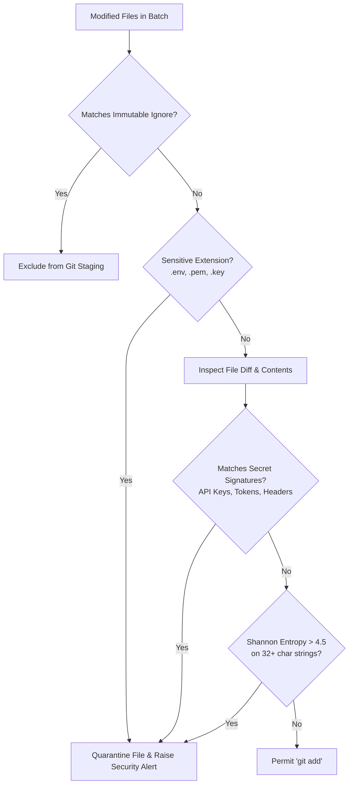

# NIMO-DECK Security & Threat Model Specification

## 1. Security Philosophy & Principles

As a development operating system with deep access to source code, private repositories, Google Drive accounts, and filesystem watchers, NIMO-DECK enforces a defense-in-depth security model:

1. **Principle of Least Privilege:**
   Background daemons, UI renderers, and AI adapters operate with strictly scoped permissions. The Electron renderer has zero direct access to Node.js, the local filesystem, or external network sockets.
2. **Deterministic Pre-Commit Gatekeeping:**
   No file is ever committed to version control or sent to an AI provider without running through a local credential and entropy scanner.
3. **Hardware-Backed Credential Isolation:**
   API keys and OAuth tokens are never stored in plain text on disk or in the database. All secrets reside in the operating system's native secure enclave (Windows Credential Manager / macOS Keychain / Linux Secret Service) via `keytar`.
4. **Non-Destructive Operations by Design:**
   Destructive commands (force push, hard reset, uncommitted file purge) are programmatically blocked in all automated routines and require multi-step authenticated user interaction.

---

## 2. STRIDE Threat Model Analysis

| Threat Category | Potential Attack Vector | NIMO-DECK Mitigation Strategy |
| :--- | :--- | :--- |
| **Spoofing** | Malicious script impersonates NIMO-DECK to access GitHub or Google Drive APIs. | OAuth 2.0 PKCE flow with local ephemeral loopback listeners; tokens stored securely in Windows Credential Manager; IPC requests require valid window webContents identification. |
| **Tampering** | Rogue dependency modifies local Git configuration or stages malicious commits. | Real-time Git hook monitoring; strict argument sanitization for Git CLI calls (preventing shell injection); immutable audit logs with SHA-256 hash chaining. |
| **Repudiation** | An automated commit or snapshot fails or damages a repository without an audit trail. | Every file change, commit creation, remote sync, and Google Drive upload writes an immutable record to the append-only `audit_logs` table before execution. |
| **Information Disclosure** | `.env` credentials, API tokens, or private SSH keys are staged and pushed to GitHub or sent to an LLM. | Pre-commit entropy scanner, hardcoded blocklist (`.env*`, `.pem`, `id_rsa`), and automatic sanitization of AI prompt context windows. |
| **Denial of Service** | Endless filesystem mutation storm (e.g. `npm install` inside unignored folder) consumes 100% CPU. | Strict ignore list enforced before filesystem watchers attach; debounce timers with burst limits; isolated worker processes. |
| **Elevation of Privilege** | Cross-Site Scripting (XSS) in Dashboard UI achieves Remote Code Execution (RCE) on workstation. | Electron `contextIsolation: true`, `nodeIntegration: false`, `sandbox: true`, strict Content Security Policy (CSP), and typed channel-validated IPC bridges. |

---

## 3. Credential & Secret Management

### 3.1 Vault Storage Architecture
All authentication tokens and private credentials are kept strictly out of SQLite and configuration files:

```
┌────────────────────────────────────────────────────────┐
│                    NIMO-DECK Storage                   │
│                                                        │
│   SQLite Database (~/.nimo-deck/db)                    │
│   ├── Project metadata (paths, remote URLs)            │
│   ├── Commit history & audit logs                      │
│   └── (Zero Passwords / Zero Tokens)                   │
│                                                        │
│   Windows Credential Manager (via keytar)              │
│   ├── Service: "NIMO-DECK" / Account: "github_pat"     │
│   ├── Service: "NIMO-DECK" / Account: "gdrive_refresh" │
│   └── Service: "NIMO-DECK" / Account: "openrouter_key" │
└────────────────────────────────────────────────────────┘
```

### 3.2 Secure API Token Flow
- Tokens are loaded into memory exclusively in the Node.js main process / secure worker.
- The UI renderer only receives boolean capability flags (`isGitHubConnected: true`), never raw secret strings.
- Outgoing API requests inject credentials immediately prior to transport over HTTPS (TLS 1.3).

---

## 4. Pre-Commit Secret Scanner Engine

The pre-commit scanner runs automatically on every batch of modified files prior to executing `git add`:



### 4.3 High-Entropy String Scanner Algorithm
```typescript
export function calculateShannonEntropy(str: string): number {
  const map: Record<string, number> = {};
  for (let i = 0; i < str.length; i++) {
    const char = str[i];
    map[char] = (map[char] || 0) + 1;
  }
  let entropy = 0;
  for (const char in map) {
    const p = map[char] / str.length;
    entropy -= p * Math.log2(p);
  }
  return entropy; // Strings with entropy > 4.5 and length > 24 are flagged as probable secrets
}
```

---

## 5. Filesystem Sandboxing & Path Traversal Guards

To prevent symlink attacks or path manipulation from reading or altering arbitrary system directories:

1. **Root Boundary Verification:**
   Every file operation verifies that `path.resolve(targetFile).startsWith(project.localPath)`.
2. **Symlink Resolution:**
   Paths are dereferenced using `fs.realpathSync` to guarantee symlinks pointing outside the workspace boundary (e.g. to `C:\Windows\` or `C:\Users\<user>\.ssh`) are blocked and logged.
3. **Command Sanitization:**
   Git commands are never invoked through shell interpolation (`exec('git add ' + path)`). Instead, all invocations pass through structured child process argument arrays (`execFile('git', ['add', '--', sanitizedRelativePath])`), completely preventing shell command injection.

---

## 6. Desktop & Renderer Isolation (Electron Security)

The Electron application follows strict security best practices:

```typescript
// Electron Main Process Window Configuration
const mainWindow = new BrowserWindow({
  webPreferences: {
    contextIsolation: true,
    nodeIntegration: false,
    sandbox: true,
    webSecurity: true,
    allowRunningInsecureContent: false,
    preload: path.join(__dirname, 'preload.js')
  }
});
```

### Content Security Policy (CSP)
```http
Content-Security-Policy: default-src 'self'; script-src 'self'; style-src 'self' 'unsafe-inline'; img-src 'self' data: https://avatars.githubusercontent.com; font-src 'self'; connect-src 'self' https://api.github.com https://openrouter.ai;
```

---

## 7. Non-Destructive Operation Safeguards

NIMO-DECK enforces programmatic locks on all high-risk Git and filesystem commands:

| Action | Allowed in Automated Sync? | Manual User Requirement |
| :--- | :--- | :--- |
| `git commit` | Yes (Safe batching) | Automatic |
| `git push` | Yes (Fast-forward only) | Automatic or Configurable |
| `git push --force` | **STRICTLY FORBIDDEN** | Explicit UI button with typed confirmation modal |
| `git pull --ff-only` | Yes | Automatic |
| `git reset --hard` | **STRICTLY FORBIDDEN** | Disabled; replaced with nondestructive stash/checkout |
| `git clean -fd` | **STRICTLY FORBIDDEN** | Disabled in all automated workflows |
| Google Drive Overwrite | **STRICTLY FORBIDDEN** | Every snapshot is a new timestamped version |

---

## 8. Multi-Device & Logging Security (Phase 8 Hardening)

### 8.1 Production Logging Redaction
All structured log output produced by `ProductionLogger` automatically scrubs sensitive strings before writing to disk or stdout:
- GitHub PATs (`ghp_*`, `github_pat_*`)
- AI provider tokens (`sk-*`, `AIza*`)
- Bearer tokens in HTTP headers (`Bearer ...`)
- Explicit secret JSON keys (`client_secret`, `apiKey`, `password`, `privateKey`)

### 8.2 Multi-Device Isolation Invariant
- **Zero Local Path Transmission:** Absolute local filesystem paths (e.g. `C:\Users\manav\OneDrive\...`) exist only on the originating machine and are never transmitted in cross-device synchronization payloads.
- **Zero Public Port Exposure:** Workstations run with zero inbound public listening ports, communicating outbound-only via TLS 1.3 to GitHub, Google Drive, and the Cloud Control Plane.
- **Cryptographic Signatures:** Every outbound metadata synchronization payload is signed using the workstation's device keypair to prevent tampering.
- **Sliding-Window Rate Limiting:** The cloud control plane enforces sliding-window IP rate limiting (120 req/min) to prevent brute-force attacks on pairing and auth endpoints.
