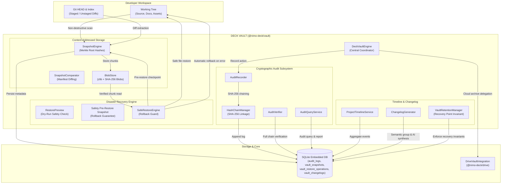
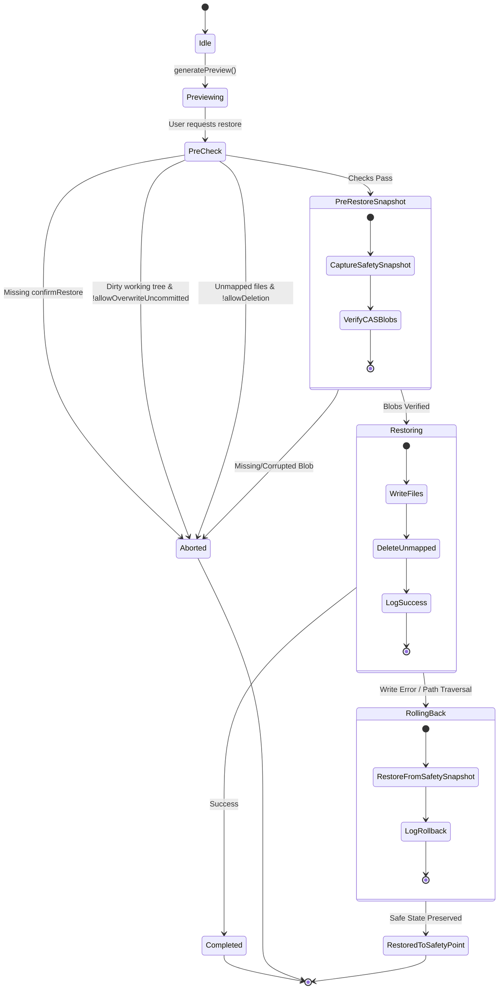

# DECK VAULT — Version History, Audit & Disaster Recovery Engine

## 1. Overview & Architectural Role

DECK VAULT (`@nimo-deck/vault`) is the immutable history, content-addressed snapshot, tamper-evident audit, and disaster recovery subsystem of NIMO-DECK. While Git and GitHub maintain the canonical revision history of source files, and Google Drive provides offsite archival backup, DECK VAULT provides the local safety net:

1. **Tamper-Evident Audit Logging:** Cryptographically chained records capturing every high-consequence operation (Git commits, cloud backups, restore actions, AI analyses, configuration changes) with SHA-256 hash chaining.
2. **Content-Addressed Differential Snapshots (CAS):** Non-destructive snapshots of local working trees (committed, staged, unstaged) with zlib compression, chunk deduplication, and root Merkle digest calculations.
3. **Fail-Safe Disaster Restoration:** Multi-stage safe restore engine featuring pre-restore safety snapshots, dry-run previews, CAS integrity verification, dirty working tree protections, path-traversal defenses, and automated rollback upon failure.
4. **Unified Developer Timeline:** Chronological timeline aggregating events across Git commits, sync cycles, Drive backups, AI analyses, snapshots, and user actions with full search, type filtering, and date range support.
5. **Grounded Release Changelogs:** Conventional Commit grouping with AI narrative synthesis clearly demarcating `[VERIFIED_GIT_HISTORY]` from `[AI_GENERATED_INTERPRETATION]`.
6. **Disaster Recovery & Retention Invariants:** Guaranteed preservation of the newest recovery point and all pinned snapshots (`isPinned: true`).

---

## 2. Architecture & Data Flow



---

## 3. Cryptographic Audit Engine

### 3.1 Hash Chaining Algorithm
Every record in `audit_logs` maintains a deterministic SHA-256 pointer to its predecessor:

$$\text{EntryHash}_n = \text{SHA256}(\text{PrevLogHash}_{n-1} + ":" + \text{id} + ":" + \text{actor} + ":" + \text{action} + ":" + \text{payloadHash} + ":" + \text{createdAt})$$

- For the initial entry in the database, $\text{PrevLogHash}_0$ is initialized to the well-known `GENESIS_HASH`:
  ```
  0000000000000000000000000000000000000000000000000000000000000000
  ```
- Any modification to an audit log row (altering `payload_hash`, modifying `action`, editing `created_at`, or deleting an intermediate row) causes an immediate cascade failure during full chain verification.

### 3.2 Security Model Notice
The audit engine provides a transparent security disclosure via `getSecurityModelNotice()`:
- **Tamper-Evident:** Cryptographic verification confirms internal continuity and immediately exposes unauthorized mutations.
- **Not Immutable Hardware:** Because SQLite resides on the host filesystem, an adversary with OS root access could rewrite the entire database file and reconstruct a valid hash chain from scratch. For high-security environments, periodic root hashes should be anchored to an external timestamping service or Git commit SHA.

---

## 4. Content-Addressed Storage (CAS) & Differential Snapshots

### 4.1 Chunk Storage Structure
Blobs are stored under `<vaultDir>/blobs/<prefix>/<sha256>`:
- **Prefix:** First 2 hex characters of the content SHA-256 digest to prevent filesystem directory bloating.
- **Compression:** Zlib deflation by default to reduce disk footprint by 40-70% for source code.
- **Deduplication:** When storing a file whose SHA-256 already exists on disk, `BlobStore.store()` skips the write and returns `wasNew: false`.

### 4.2 Non-Destructive Snapshot Creation
1. Recursively enumerates workspace files while strictly enforcing `IMMUTABLE_IGNORED_PATTERNS` (`node_modules`, `.git`, `.env*`, build artifacts).
2. Computes the SHA-256 hash of each eligible file and stores the blob in CAS.
3. Extracts Git HEAD commit SHA, branch name, staged diff (`git diff --cached`), and unstaged diff (`git diff`).
4. Generates a deterministic Merkle root digest:
   $$\text{RootHash} = \text{SHA256}\left(\sum_{f \in \text{files}} \text{path}_f + ":" + \text{sha256}_f + ":" + \text{size}_f\right)$$
5. Persists the snapshot manifest and metadata into `vault_snapshots`.
6. Leaves the original working tree completely untouched throughout the operation.

---

## 5. Fail-Safe Disaster Restoration

### 5.1 Safe Restore State Machine



### 5.2 Critical Safety Guarantees
1. **Explicit Confirmation Gate:** Restoration unconditionally throws if `confirmRestore: true` is not provided.
2. **Pre-Restore Safety Snapshot:** Before altering a single byte on disk, `SafeRestoreEngine` captures a `SAFETY_PRE_RESTORE` pinned snapshot of the current workspace.
3. **CAS Integrity Verification:** All required blob hashes are verified in the content-addressed store prior to beginning any disk writes.
4. **Path-Traversal Defense:** Every target path is sanitized by stripping directory traversal sequences (`../`) and asserted to resolve inside `projectPath`.
5. **Automatic Rollback:** If an unhandled I/O exception occurs during restoration, all modified files are immediately reverted to the state preserved in the safety snapshot.

---

## 6. Retention & Disaster Recovery Invariants

To prevent disk saturation while guaranteeing business continuity:
1. **The Latest Recovery Point Invariant:** The most recent snapshot for any project is **never deleted**, regardless of age or count threshold policies. A project always has at least one restorable checkpoint.
2. **Pinned Snapshot Protection (`isPinned: true`):** Snapshots flagged by developers or generated as pre-restore safety points are exempted from automated pruning.
3. **Deterministic Pruning:** Retention algorithms evaluate snapshots from oldest to newest, maintaining a guaranteed minimum recovery window.
